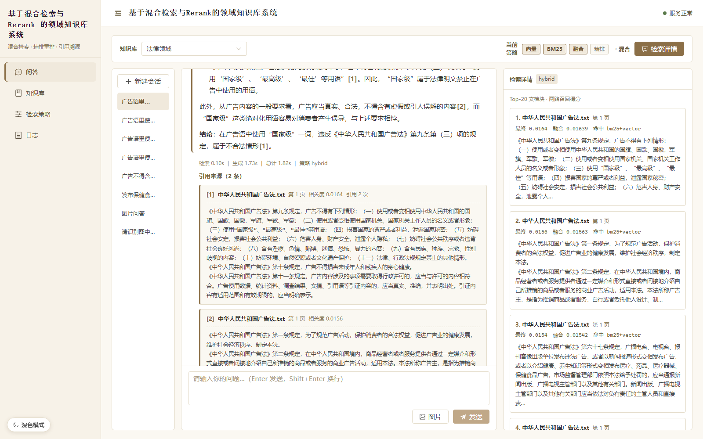
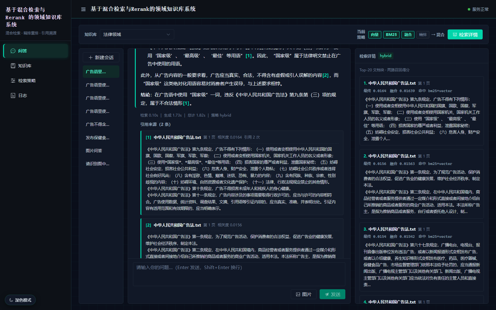
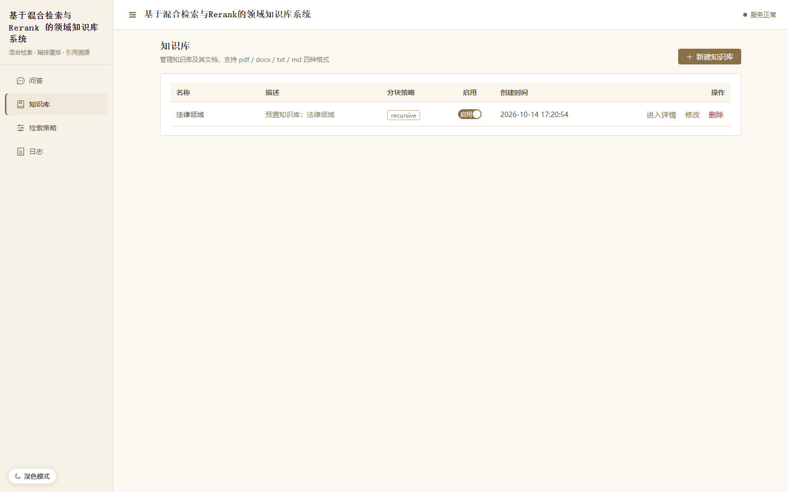
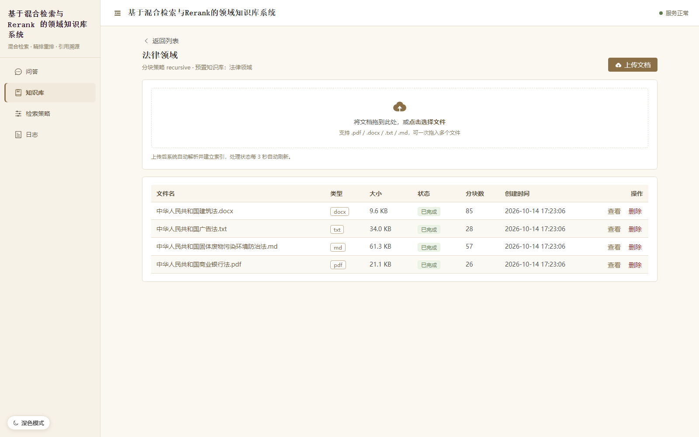
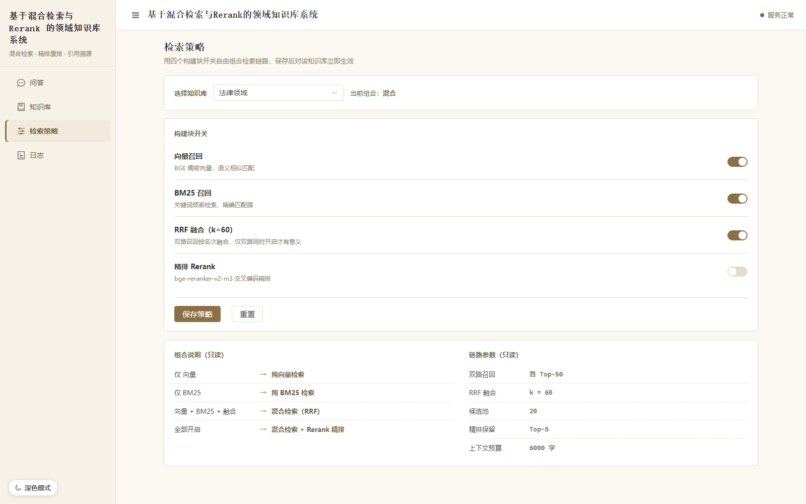
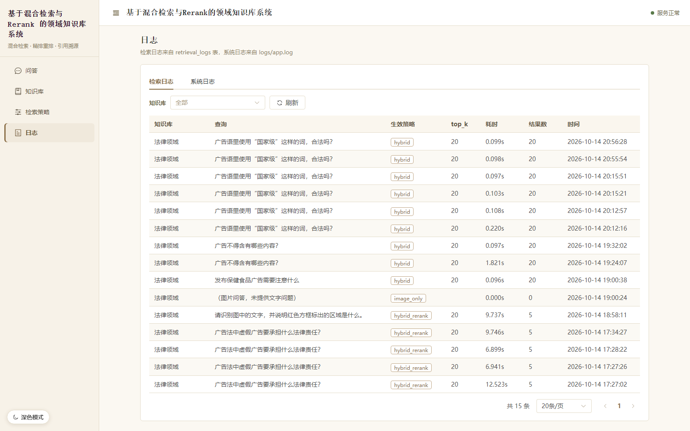

# 基于混合检索与 Rerank 的领域知识库系统

> 面向**特定领域长文档**的检索增强问答系统。
>
> 核心思路：**稠密向量检索（BGE）+ BM25 稀疏检索的混合召回 → RRF 融合 → 交叉编码器精排 → LLM 生成带引用溯源的答案**。
> 针对「用户不会用规章制度的措辞提问」这一真实痛点，重点解决**口语化提问下的召回**与**答案可溯源**两个问题。

本仓库包含同一套检索链路的两种形态：

| 形态 | 目录 | 定位 | 技术形态 |
| --- | --- | --- | --- |
| **验证版（Demo）** | [`demo/`](demo/) | 聚焦验证混合检索 + Rerank 的核心链路与效果，附带完整评估体系与实验报告 | Streamlit 前端 + FastAPI 服务 |
| **产品级系统** | [`product/`](product/) | 把验证版链路产品化：多知识库管理、文档上传入库、多轮对话、日志与可观测、深色模式 | Vue 3 + Element Plus 前端 + FastAPI 后端 |

---

## 界面预览

> 以下为**产品级系统**（`product/`）的实际界面，由无头浏览器驱动真实交互后截取——其中问答页是实际发问、等待流式回答结束后再截的，检索详情面板也是脚本点开后的状态，非静态摆拍。

<table>
  <tr>
    <td align="center"><b>问答页 · 浅色</b><br /></td>
    <td align="center"><b>问答页 · 深色科技风</b><br /></td>
  </tr>
  <tr>
    <td align="center"><b>知识库列表</b><br /></td>
    <td align="center"><b>知识库详情 · 文档管理</b><br /></td>
  </tr>
  <tr>
    <td align="center"><b>检索策略配置</b><br /></td>
    <td align="center"><b>日志 · 检索日志 / 系统日志</b><br /></td>
  </tr>
</table>

产品级系统共四个固定页面：**问答 / 知识库 / 检索策略 / 日志**，无登录页与设置页。

---

## 一、要解决的问题

特定领域文档通常有几百页、几十份文件，条款分散、交叉引用多，而用户的提问多为口语化表述。

- 只做关键词匹配不够：用户不会照着条款措辞提问；
- 只做向量检索又会漏掉文号、条款号这类精确信息。

因此采用**混合检索**。同时，垂直领域问答有一条红线：**答案必须能追溯到原文**——编造的后果远比「答不出来」严重，所以链路强制 `[n]` 引用标注并回映射到「文件名 + 页码」。

---

## 二、核心检索链路（两版一致）

一次问答默认走完整链路，参数固定为已验证的确定性配置：

```
双路召回（向量 Top-50  ‖  BM25 Top-50）
        ↓
RRF 融合（k = 60）→ 候选池保留 20 条
        ↓
交叉编码器精排 bge-reranker-v2-m3 → 取 Top-5
        ↓
拼入上下文（预算 6000 字）→ DeepSeek 生成带引用的答案
```

产品级系统中，该链路的**向量召回 / BM25 召回 / RRF 融合 / 精排**四个环节被拆成可自由开关的「构建块」，用户可组合出验证版已验证的四种策略（`vector` / `bm25` / `hybrid` / `hybrid_rerank`）。

---

## 三、技术栈

### 检索与模型（两版共用）

- 稠密召回：`BAAI/bge-large-zh-v1.5`（sentence-transformers，本地推理，维度 1024）
- 稀疏召回：`BM25Okapi` + `jieba` 中文分词
- 融合：RRF（默认）或加权融合
- 精排：`BAAI/bge-reranker-v2-m3` 交叉编码器（CrossEncoder）
- 向量库：Chroma（LangChain 集成）
- 生成：DeepSeek（OpenAI 兼容接口，`deepseek-chat`；图像问答用 `deepseek-flash`）

### 验证版（`demo/`）

- 前端：Streamlit（对话界面 + 检索调试面板）
- 服务：FastAPI + 业务编排
- 评估：100 条人工标注测试集 + Recall/MRR/nDCG + 消融实验 + LLM-as-Judge

### 产品级系统（`product/`）

- 后端：FastAPI + Uvicorn、SQLAlchemy 2.0（async）+ aiomysql + Alembic（MySQL 8）、Pydantic v2
- 异步任务：Celery（broker 与结果后端为 Redis，缺失时可降级为线程池同步入库）
- 对象存储：本地 `storage/`（默认）或 MinIO
- 前端：Vue 3 + Element Plus + Pinia + Vite，axios 请求，marked 渲染 Markdown
- 可观测：loguru 日志 + prometheus-client 指标

---

## 四、目录结构

```
.
├── demo/                 验证版（Streamlit + FastAPI + 评估体系）
│   ├── app.py            Streamlit 前端入口（对话 + 检索调试）
│   ├── src/              api / ingest / retrieval / generation / evaluation
│   ├── data/eval/        测试集与评估产物（含 EXPERIMENT_REPORT.md）
│   └── README.md         验证版详细文档
├── product/              产品级系统（Vue 3 + FastAPI）
│   ├── backend/          FastAPI 服务、检索链路、异步入库、迁移脚本
│   ├── frontend/         Vue 3 四页应用（问答 / 知识库 / 检索策略 / 日志）
│   ├── resource/         预置语料（法律领域，只读引用）
│   └── README.md         产品级系统详细文档
├── docs/                 项目文档与界面截图（docs/images/*.png）
├── LICENSE               PolyForm Noncommercial License 1.0.0
└── README.md             本文件
```

---

## 五、快速开始

> 两个形态的索引、数据、配置相互独立，可按需单独运行。详细步骤见各自的 README。

### 验证版（`demo/`）

```powershell
cd demo

# 安装依赖（Python 3.11）
pip install -r requirements.txt

# 配置 .env（DeepSeek 密钥等）

# 后端服务
python -m src.api.main

# 前端界面（另开一个终端）
streamlit run app.py
```

详见 [demo/README.md](demo/README.md)。

### 产品级系统（`product/`）

```powershell
# 后端
cd product\backend
uv venv --python 3.11 .venv
uv pip install --python .venv\Scripts\python.exe -r requirements.txt
Copy-Item .env.example .env        # 编辑 .env，填写 RAG_LLM__API_KEY
.\.venv\Scripts\Activate.ps1
python scripts\init_db.py          # 建库 + 迁移建表
python scripts\seed_data.py        # 灌入预置语料「法律领域」
python -m src.api.main             # 启动后端（http://127.0.0.1:8000）

# 前端（另开一个终端）
cd product\frontend
npm install
npm run dev                        # http://localhost:5173
```

详见 [product/README.md](product/README.md)。

---

## 六、实验与评估（`demo/`）

验证版内置 100 条人工标注测试集（三层类别），零 token 可复现，四种策略全量结果如下：

| 策略 | Recall@1 | Recall@3 | Recall@5 | MRR | nDCG | 平均首命中名次 | 秒/题 |
| --- | --- | --- | --- | --- | --- | --- | --- |
| vector（纯向量） | 0.1757 | 0.3498 | 0.4782 | 0.6242 | 0.5334 | 2.89 | 2.05 |
| bm25（纯关键词） | 0.1718 | 0.3287 | 0.4715 | 0.5837 | 0.5167 | 3.18 | 0.007 |
| hybrid（RRF 融合） | 0.2033 | 0.3957 | 0.4720 | 0.6462 | 0.5550 | 3.15 | 2.06 |
| **hybrid_rerank（+精排）** | **0.2602** | **0.4570** | **0.5460** | **0.6825** | 0.5444 | **1.62** | 19.12 |

> **混合 + Rerank 相比最佳基线**：Recall@1 `+48.1%`、Recall@3 `+30.6%`、Recall@5 `+14.2%`、MRR `+9.3%`，平均首命中名次前移 44%。代价是单题耗时 `×9.3`（CPU 精排是瓶颈，GPU 可提速 20~50 倍）。

### 检索节省的 token

上表是 100 题全量、**零 token** 可复现的检索指标；下面的 token 数是生成质量评估的**实测**值（因耗 token 只跑 10 题/策略，每题含「生成 + 裁判」两次调用）：

| 策略 | 10 题生成 token 合计 | 单题平均 | 相对基准 |
| --- | --- | --- | --- |
| vector（纯向量） | 41,227 | 4,123 | — |
| bm25（纯关键词） | 40,576 | 4,058 | — |
| hybrid（RRF 融合） | 41,381 | 4,138 | 基准 |
| **hybrid_rerank（+精排）** | **18,306** | **1,831** | **−55.8%** |

> **省在哪**：`hybrid_rerank` 比 `hybrid` 少 **23,075 token**（10 题合计），单题从 4,138 降到 1,831 —— **省 2,308 token/题，降幅 55.8%**。代价几乎为零：faithfulness 4.8 vs 4.9、answer_relevancy 4.8 vs 4.9，只差 0.1 分。原因是精排把送入 LLM 的上下文收敛到最相关的 Top-5，而不是把候选池整批塞进去。

> **上下文预算 vs 全量语料**：recursive 分块共 290 块、均值 352 字，语料约 **10.2 万字**。若不检索而整库直塞，单次上下文就是 10 万字量级；本项目按 `context_max_chars=6000`（字符，非 token）硬预算裁剪，单次只送约 6000 字 —— **约为全量的 6%，上下文体积被压到 1/17**。检索真正节省的 token 正来自这一层压缩。

> **检索本身不计费**：双路召回（BGE 稠密 + BM25）、RRF 融合、CrossEncoder 精排全部跑在本地模型上，**不消耗任何 LLM token**；只有最后的生成阶段才产生 token 成本。

完整报告见 [demo/data/eval/results/EXPERIMENT_REPORT.md](demo/data/eval/results/EXPERIMENT_REPORT.md)。

> 说明：**产品级系统（`product/`）不包含评估模块**，所有评估相关内容保留在验证版中。

---

## 七、说明与限制

- **许可证**：本项目采用 [PolyForm Noncommercial License 1.0.0](https://polyformproject.org/licenses/noncommercial/1.0.0)，**禁止任何商业用途**——允许个人学习、研究、教学、实验及非商业主体使用，禁止任何以商业获利为目的的使用。完整条款见 [LICENSE](LICENSE)。
- **产品级系统为单用户无认证系统**：无登录页、无用户体系、无鉴权中间件。
- **产品级系统不含 Agent 检索决策模块**：检索策略为知识库固定配置，沿用验证版已验证的确定性链路。
- **模型缓存**：两版首次运行均需联网或已具备本地模型缓存（bge-large-zh-v1.5 与 bge-reranker-v2-m3）。
- **密钥安全**：真实密钥与数据库口令请自行填写到各自的 `.env`，不要提交到仓库（仓库 `.gitignore` 已忽略相关文件）。
