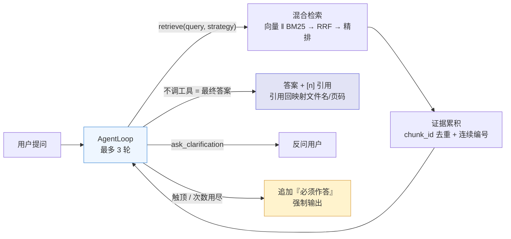

# Agentic 领域知识库系统（第三版）

> 面向领域文档的**智能体问答系统**：把「检索怎么做」交给 LLM 逐轮决策 —— 判断该不该检索、把口语改写成规范 query、选择向量 / BM25 / 融合 / 精排中的哪条链路、证据是否足够，最多 **3 轮**收敛并给出可溯源的答案。
>
> 检索、融合、精排、生成、引用与入库能力沿用第二版（`product/`）；本版新增的是**调度层**（Agent 循环、工具、提示词）与**前端决策可视化**。

---

## 功能特性

- **智能问答（Agent 自主决策）**：LLM 每轮只做一件事——调用 `retrieve`、调用 `ask_clarification`，或直接输出最终答案。闲聊不进检索；指代不明先反问；证据不足如实拒答，不臆造。
- **决策轨迹可视化**：右侧面板按轮次展示时间线（行动类型、改写后的 query、所选策略、命中片段、耗时），片段行复用检索详情的视觉；历史会话可从落库轨迹还原。
- **三轮硬约束**：单问题最多 3 轮决策，第 3 轮必须直接作答；未知工具、检索次数用尽、空 query 也会立即收敛，不存在无限循环。
- **引用可溯源**：跨轮证据按 `chunk_id` 去重、编号连续，答案中的 `[n]` 精确映射回「文件名 + 页码」。
- **多知识库管理**：新建 / 编辑（名称、简介、分块策略）/ 启停 / 删除，知识库之间彼此隔离。
- **文档入库**：pdf / docx / txt / md 上传，解析、分块并建立向量与 BM25 双索引，支持在线预览。
- **检索策略调试**：在线对比 `vector` / `bm25` / `hybrid` / `hybrid_rerank` 四档的召回结果与耗时分解。
- **日志与深色模式**：检索日志、系统日志两个标签页；左下角切换浅色 / 深色科技风，偏好存于 localStorage。

---

## 系统架构

### 一次 Agent 问答



### 三轮决策的分工

| 轮次 | LLM 的职责 | 系统动作 |
| --- | --- | --- |
| 第 1 轮 | 意图识别：闲聊直接答 / 歧义反问 / 需要依据则改写 query 并检索 | 检索结果编号后回填为 tool 消息，进入下一轮 |
| 第 2 轮 | 评估证据：足够则作答；不足则换关键词或换角度再检索（禁止完全相同 query） | 同上，检索调用次数累计 |
| 第 3 轮 | 必须直接输出最终回答，禁止再调用任何工具 | 循环到顶后收敛 |

三条保底机制：

1. `for` 循环封顶 `MAX_DECISION_ROUNDS`（默认 3）；
2. 「不调工具即输出 content」——该 content 直接作为最终答案（方案 A，不再二次生成）；
3. 触顶或异常后追加 `FORCE_ANSWER_INSTRUCTION` 再请求一次，强制产出答案。

---

## 技术栈

### 后端

- Web 框架：FastAPI + Uvicorn
- 数据访问：SQLAlchemy 2.0（async）+ aiomysql + Alembic，数据库 MySQL
- 数据模型：Pydantic v2 / pydantic-settings
- 异步任务：Celery（broker 与结果后端均为 Redis，可选）
- 对象存储：local（默认，落本地 `storage/`）或 MinIO
- 可观测：loguru 日志 + prometheus-client 指标

### 前端

- 框架：React 18 + Vite 5
- 路由 / 状态：React Router 6 + Zustand 4
- 请求 / 渲染：axios + marked
- 样式：自写 CSS（复用 `theme.css` 的 CSS 变量与深色主题），不引入 UI 组件库

### 检索与模型

- 稠密召回：BAAI/bge-large-zh-v1.5（sentence-transformers，本地推理，1024 维）
- 稀疏召回：BM25Okapi + jieba 分词
- 融合：RRF（k=60）；精排：BAAI/bge-reranker-v2-m3 交叉编码器
- 向量库：Chroma（本地持久化）
- 决策与生成：DeepSeek `deepseek-chat`（OpenAI 兼容接口，原生 Function Calling，`temperature=0`）

### Agent 实现

- 不依赖 LangChain Agent / 自建 ReAct 文本协议，直接用 LLM 原生工具调用；
- 单轮决策 → 执行 → 回填 → 下一轮，状态显式保存在 `AgentState`；
- 检索与 LLM 调用均为阻塞操作，统一在线程池执行。

---

## 目录结构

```
agent/
├── backend/
│   ├── alembic/                数据库迁移脚本（versions/*）
│   ├── scripts/
│   │   ├── init_db.py          建库 + 建表（默认走 Alembic）
│   │   └── seed_data.py        预置「法律领域」知识库并导入语料
│   ├── src/
│   │   ├── agent/              ⭐ 本版新增：调度层
│   │   │   ├── loop.py         AgentLoop：逐轮决策 + 三档收敛保底
│   │   │   ├── state.py        消息 / 证据 / 轨迹状态（chunk_id 去重、连续编号）
│   │   │   ├── tools.py        工具层：策略开关映射 + 复用 retrieval_service
│   │   │   └── prompts.py      AGENT_SYSTEM / TOOL_SCHEMAS / 兜底指令
│   │   ├── api/                main.py（入口）、v1/（agent / chat / kb / document / retrieval / log）
│   │   ├── core/               config.py（含 agent 分组）、logging.py
│   │   ├── db/                 引擎与会话、models/（ORM）
│   │   ├── ingest/             解析、分块、索引写入
│   │   ├── retrieval/          向量召回、BM25、RRF、精排、链路组装
│   │   ├── generation/         Prompt 组装、DeepSeek 调用（新增 tools 透传与 chat()）、引用解析
│   │   ├── services/           agent_service（门面）、chat_service（会话/消息/SSE）、kb / document / ingest / retrieval
│   │   ├── schemas/            请求 / 响应模型（agent.py 为智能问答契约）
│   │   ├── tasks/              Celery 应用与文档解析任务
│   │   └── utils/              存储抽象、Redis、MinIO 客户端
│   ├── tests/                  pytest 冒烟测试
│   ├── requirements.txt
│   ├── .env.example            环境变量模板
│   ├── Dockerfile
│   └── docker-compose.yml      MySQL + Redis + MinIO + 后端
└── frontend/
    ├── src/
    │   ├── api/                axios 封装：agent / chat / kb / document / log
    │   ├── components/         DecisionTrace（决策轨迹）、RetrievalDetail、ChatMessage、CitationCard、StrategyBuilder、MainLayout
    │   ├── pages/              AgentChat（智能问答）/ KnowledgeBase / RetrievalStrategy / Logs
    │   ├── stores/             Zustand：kb / chat / agent
    │   ├── assets/             theme.css（主题与深色变量）
    │   ├── styles/             app.css（布局与组件样式）
    │   ├── router.jsx
    │   └── main.jsx
    ├── index.html
    ├── package.json
    └── vite.config.js
```

前端固定四个页面：**智能问答 / 知识库 / 检索策略 / 日志**，无登录页与设置页。

---

## 快速开始

### 环境要求

- Python 3.11.9（Windows x64）
- Node.js 18+ 与 npm
- MySQL 8（必需）；Redis、MinIO 可选
- Docker 可选（一键启动基础设施）

### 后端

```powershell
cd agent\backend

# 1. 创建虚拟环境并安装依赖
uv venv --python 3.11 .venv
uv pip install --python .venv\Scripts\python.exe -r requirements.txt
# 或：python -m venv .venv && .\.venv\Scripts\Activate.ps1 && pip install -r requirements.txt

# 2. 准备配置：复制模板后至少填写四项
Copy-Item .env.example .env
#   RAG_LLM__API_KEY      真实的 DeepSeek 密钥
#   RAG_DATABASE__URL     本机 MySQL 连接串
#   RAG_EMBEDDING__CACHE_DIR  仓库根 .hf-cache 的绝对路径（模板中已写成相对路径，可直接用）
#   RAG_RESOURCE_DIR      预置语料目录（默认指向 product/resource）

# 3. 启动 MySQL（本机未运行时可用 Docker 只拉起数据库）
docker compose up -d mysql redis minio

# 4. 初始化数据库并灌入预置语料
python scripts\init_db.py
python scripts\seed_data.py

# 5. 自检与启动
python -m src.core.config      # 打印配置（含 agent 分组，max_decision_rounds=3）
python -m src.api.main         # 默认 http://127.0.0.1:8000
```

首次启动会在后台线程预热向量与精排模型（CPU 下精排加载约 20 秒），期间 `/health` 返回 `warmed_up=false`。

### 前端

```powershell
cd agent\frontend
npm install
npm run dev
```

### 访问地址

- 前端：http://localhost:5173（默认落到 `/agent` 智能问答页）
- 后端 API：http://localhost:8000（业务前缀 `/api/v1`）
- 交互式文档：http://localhost:8000/docs

> 本版与 `product/` 使用相同端口（8000 / 5173），两者不要同时启动；`demo/` 使用 8100 / 8501，可与任一版并行。

---

## 配置说明

命名规则：`RAG_<分组>__<字段>`（双下划线表示嵌套），默认值在 `src/core/config.py`，可被 `.env` 覆盖。

### Agent 分组（本版新增）

| 环境变量 | 默认值 | 说明 |
| --- | --- | --- |
| `RAG_AGENT__MAX_DECISION_ROUNDS` | `3` | 单问题最多决策轮数（1~5，硬约束） |
| `RAG_AGENT__MODEL` | `deepseek-chat` | 决策用模型 |
| `RAG_AGENT__TEMPERATURE` | `0.0` | 决策需稳定，默认 0 |
| `RAG_AGENT__MAX_TOKENS` | `1024` | 单轮决策输出上限 |
| `RAG_AGENT__MAX_RETRIEVE_CALLS` | `3` | 检索工具最多调用次数，用尽即强制作答 |

### 复用字段（与 product 相同）

- `RAG_LLM__API_KEY` / `RAG_LLM__MODEL` / `RAG_LLM__BASE_URL`：DeepSeek 配置
- `RAG_DATABASE__URL`：MySQL 异步连接串；`RAG_REDIS__URL`：Redis（Celery）
- `RAG_STORAGE__TYPE`：`local` | `minio`
- `RAG_EMBEDDING__OFFLINE` / `RAG_EMBEDDING__CACHE_DIR`：离线模式与模型缓存
- `RAG_RESOURCE_DIR`：种子语料目录（只读引用，不复制原文）
- 检索链路参数（`DENSE_TOP_K=50` / `SPARSE_TOP_K=50` / `TOP_K=20` / `RRF_K=60` / `RERANK__TOP_K=5` / `CONTEXT_MAX_CHARS=6000`）一般无需修改

安全提示：`.env` 已被 `agent/.gitignore` 忽略，密钥只放本地。

---

## 主要 API 一览

业务接口统一挂载在 `/api/v1` 下。

### 智能问答

| 方法 | 路径 | 用途 |
| --- | --- | --- |
| POST | `/agent/chat` | 智能问答（非流式），返回答案、引用、决策轨迹、轮数 |
| POST | `/agent/chat/stream` | 智能问答（SSE）：`meta → agent_step×N → delta → done` |

### 会话

| 方法 | 路径 | 用途 |
| --- | --- | --- |
| GET | `/conversations` | 会话列表（可按 `kb_id` 过滤） |
| GET | `/conversations/{conversation_id}/messages` | 会话消息（含 `latency.agent_trace`） |
| DELETE | `/conversations/{conversation_id}` | 删除会话 |
| DELETE | `/conversations` | 清空会话（可按 `kb_id` 过滤） |

### 知识库 / 文档 / 检索

| 方法 | 路径 | 用途 |
| --- | --- | --- |
| GET / POST | `/kb` | 知识库列表 / 新建 |
| GET / PUT / DELETE | `/kb/{kb_id}` | 详情 / 更新 / 删除 |
| PATCH | `/kb/{kb_id}/strategies` | 更新知识库默认检索构建块 |
| POST / GET | `/kb/{kb_id}/documents` | 上传文档 / 文档列表 |
| GET / DELETE | `/documents/{doc_id}` | 文档详情 / 删除 |
| GET | `/documents/{doc_id}/file` | 预览或下载原文（`download=true` 下载） |
| POST | `/kb/{kb_id}/retrieve` | 检索调试（只检索不生成，可指定四档策略） |

### 日志与服务

| 方法 | 路径 | 用途 |
| --- | --- | --- |
| GET | `/logs/retrieval` | 检索日志（分页，可按 `kb_id` 过滤） |
| GET | `/logs/system` | 系统日志（`logs/app.log` 尾部） |
| GET | `/health` | 健康检查（含 `warmed_up`、Redis 状态） |
| POST | `/warmup` | 手动触发热身 |
| GET | `/config` | 当前生效配置（密钥脱敏） |
| GET | `/metrics` | Prometheus 指标 |

---

## 决策轨迹与流式契约

### SSE 事件顺序

```
meta           { conversation_id, agent: true }
agent_step ×N  { step }        # 每轮一条，按 round 升序
delta          { delta }       # 最终答案全文（一次推送）
done           { response }    # 完整响应对象，与 /agent/chat 一致
```

### 单轮 `agent_step` 结构

```json
{
  "round": 2,
  "action": "retrieve",
  "tool": "retrieve",
  "args": {"query": "施工许可证 申领条件", "strategy": "hybrid_rerank"},
  "result_count": 5,
  "docs": [{"chunk_id": "...", "rank": 1, "source": "...", "page": 3, "score": 0.99}],
  "strategy": "hybrid_rerank",
  "stats": {"dense": 50, "sparse": 50, "overlap": 31, "merged": 63, "reranked": 5},
  "llm_usage": {"prompt_tokens": 0, "completion_tokens": 0, "total_tokens": 0},
  "elapsed_ms": 812
}
```

`action` 取值：`retrieve`（检索）、`ask_clarification`（反问）、`answer`（直接作答）、`force_answer`（强制作答）。

### 落库与回看

轨迹随 `Message.latency` 一起落库（`latency.agent_trace`），不额外建表；历史会话读取消息时由前端据此还原时间线。

---

## 与 demo / product 的关系

| | demo（验证版） | product（产品版） | agent（本版） |
| --- | --- | --- | --- |
| 定位 | 验证混合检索 + Rerank 链路与效果 | 多知识库、多轮对话、可观测、异步入库 | 检索决策交给 LLM 逐轮完成 |
| 检索驱动 | 固定链路 + 四档策略对比 | 知识库固定策略配置 | **LLM 逐轮决策**（改写 query、选策略、判断证据） |
| 最终答案 | PromptBuilder + 固定生成 | 同左 | **Agent 直接产出**（方案 A） |
| 前端 | Streamlit | Vue 3 + Element Plus | **React 18 + Vite** |
| 端口 | 8100 / 8501 | 8000 / 5173 | 8000 / 5173 |
| 决策上限 | — | — | **最多 3 轮，第 3 轮强制作答** |

设计文档见 [`docs/项目迁移.md`](../docs/项目迁移.md)，执行规格见 [`docs/spec.md`](../docs/spec.md)。

---

## 评估方案

本版**不含评估代码**，评估口径以文档形式固化，便于复跑与答辩，详见 [`docs/项目迁移.md` §10](../docs/项目迁移.md)。

| 类别 | 指标 | 说明 |
| --- | --- | --- |
| 程序化（零 token） | 路由准确率、chitchat 正确拦截率、knowledge 正确检索率、工具调用成功率、平均决策轮数、3 轮触顶率、重复检索率 | 解析 `agent_trace` 与标注意图对比，全量跑 |
| 检索类（沿用） | 证据 Recall@5 / MRR | 说明"链路没被 Agent 拖垮" |
| LLM 裁判（耗 token） | `faithfulness`、`answer_relevancy`、`task_completion` | 前两项沿用既有裁判；`task_completion` 为本版新增（1~5 分，判定是否真正解决提问） |

测试集建议 80 条，按「闲聊（20）/ 单跳知识（25）/ 多跳复合（20）/ 需澄清（15）」四层标注意图与 `gold_chunks`；裁判提示词、评分量程与汇总口径均在上述文档中给出。

---

## 说明与限制

- 单用户、无认证：没有登录页与鉴权中间件，接口可直接访问。
- 无评估代码：评估口径见文档，不随仓库提供测试集与脚本。
- 多模态未接入：接口保留 `image` 字段，但 Agent 决策仅使用文本问题。
- Redis 可选：Redis 未运行时问答不受影响；仅上传文档后的异步解析会降级为线程池内同步入库。
- 检索与 LLM 调用为阻塞操作，均在线程池执行，避免阻塞事件循环。
- 首次运行需联网或已备好本地模型缓存（bge-large-zh-v1.5、bge-reranker-v2-m3）；`RAG_EMBEDDING__OFFLINE=true` 时只用本地缓存。
- 预置知识库「法律领域」的语料为只读引用，入库不复制、不改写原文件。
- `.env` 不入库，请勿提交真实密钥；`indexes/`、`storage/`、`data/` 等运行产物同样被忽略。

---

## 许可证

本项目采用 [PolyForm Noncommercial License 1.0.0](https://polyformproject.org/licenses/noncommercial/1.0.0)，**禁止任何商业用途**。

- 允许：个人学习、研究、教学、实验，以及慈善机构、教育院校、公共研究组织等非商业主体使用，可复制、修改与分发（须保留许可证与版权声明）。
- 禁止：任何以商业获利为目的的使用，包括但不限于商业产品集成、付费服务、对外销售或以此提供商业支持。

完整条款见仓库根目录 [LICENSE](../LICENSE)。
