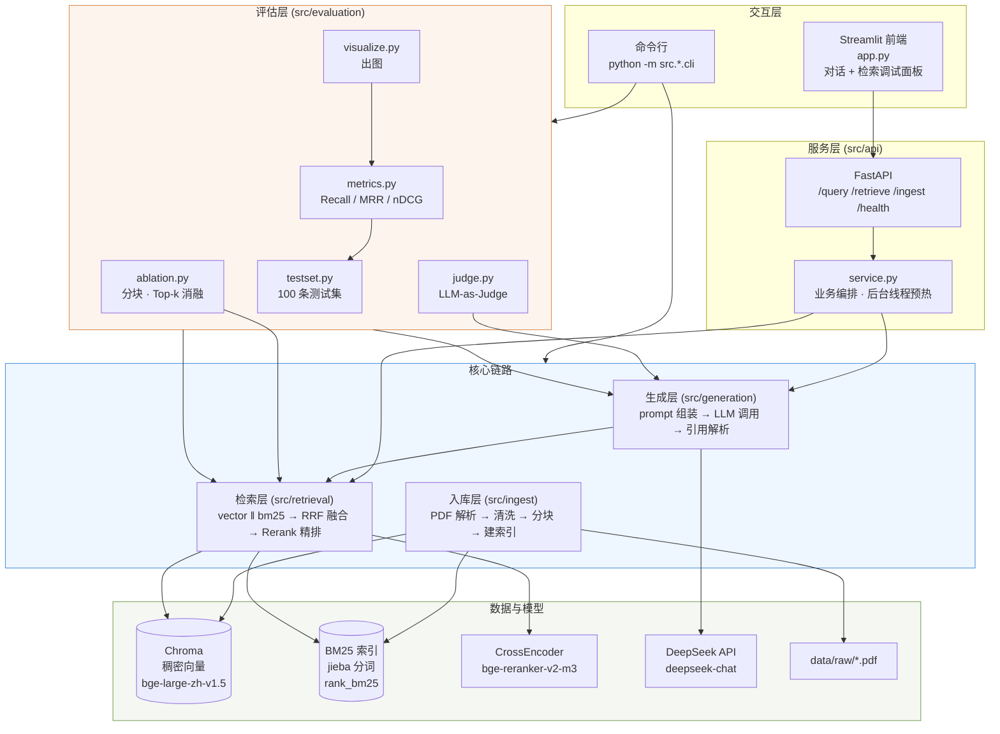
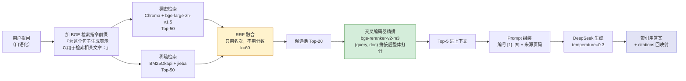
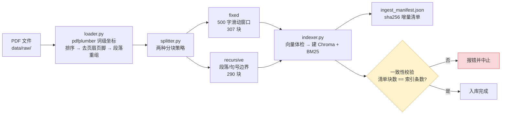
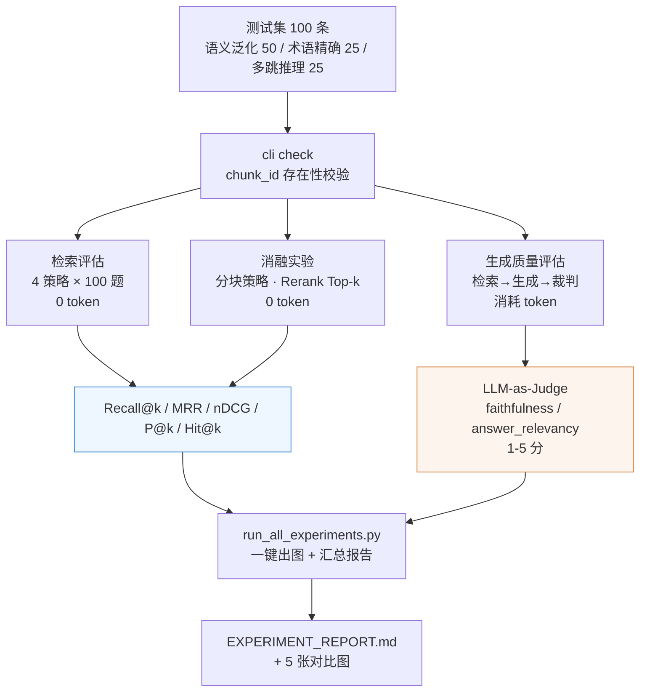

# 基于混合检索与 Rerank 的领域知识库系统

> 面向**特定领域长文档**的检索增强问答系统。
>
> 核心思路：**稠密向量检索（BGE）+ BM25 稀疏检索的混合召回 → RRF 融合 → 交叉编码器精排 → LLM 生成带引用溯源的答案**。
> 针对"用户不会用规章制度的措辞提问"这一真实痛点，重点解决**口语化提问下的召回**与**答案可溯源**两个问题。

> **项目定位**：本仓库是"基于混合检索的领域知识库系统"的 **Demo 项目**，聚焦验证混合检索 + Rerank 的核心链路与效果。
> 该系统的产品级形态（多知识库、多轮对话、可观测、异步入库）见 [product/README.md](../product/README.md)。

<br />

***

## 目录

- [一、项目简介](#一项目简介)

- [二、系统架构](#二系统架构)

- [三、技术选型](#三技术选型)

- [四、目录结构](#四目录结构)

- [五、快速开始](#五快速开始)

- [六、运行方式](#六运行方式)

- [七、实验与评估](#七实验与评估)

- [八、关键设计决策](#八关键设计决策)

- [九、踩坑记录](#九踩坑记录)

- [十、配置说明](#十配置说明)

- [十一、开发路线图与自测](#十一开发路线图与自测)

***

## 一、项目简介

### 1.1 要解决的问题

特定领域文档通常有几百页、几十份文件，条款分散、交叉引用多。而用户提问表现多为口语化输出。
**结论：只做关键词匹配不够，只做向量检索又会漏掉文号、条款号这类精确信息。** 这正是混合检索的用武之地。

此外，垂直领域问答有一条红线：**答案必须能追溯到原文**。答案如果编造，后果远比"答不出来"严重。

### 1.2 做了什么

| 能力         | 实现                                                             |
| ---------- | -------------------------------------------------------------- |
| 口语化提问也能召回  | BGE 稠密向量 + BM25 稀疏检索混合召回，RRF 融合，规避两路分数量纲不同的问题                  |
| 把最相关的放到最前面 | bge-reranker-v2-m3 交叉编码器精排，平均首命中名次从 **2.89 → 1.62**            |
| 答案可溯源      | 强制 `[n]` 标注 + 引用解析回映射到「文件名 + 页码」，并检测**不存在的引用编号**（幻觉信号）         |
| 会用、能调参     | Streamlit 对话界面 + FastAPI 服务 + 检索调试面板（可见两路召回明细与耗时）              |
| 效果可量化      | 100 条人工标注测试集（三层类别）+ Recall/MRR/nDCG + 两组消融 + LLM-as-Judge 生成质量 |

### 1.3 核心实验结果（100 题全量，零 token 可复现）

| 策略                      | Recall\@1  | Recall\@3  | Recall\@5  | MRR        | nDCG   | 平均首命中名次  | 秒/题   |
| ----------------------- | ---------- | ---------- | ---------- | ---------- | ------ | -------- | ----- |
| vector（纯向量）             | 0.1757     | 0.3498     | 0.4782     | 0.6242     | 0.5334 | 2.89     | 2.05  |
| bm25（纯关键词）              | 0.1718     | 0.3287     | 0.4715     | 0.5837     | 0.5167 | 3.18     | 0.007 |
| hybrid（RRF 融合）          | 0.2033     | 0.3957     | 0.4720     | 0.6462     | 0.5550 | 3.15     | 2.06  |
| **hybrid\_rerank（+精排）** | **0.2602** | **0.4570** | **0.5460** | **0.6825** | 0.5444 | **1.62** | 19.12 |

> **混合 + Rerank 相比最佳基线：Recall\@1** **`+48.1%`、Recall\@3** **`+30.6%`、Recall\@5** **`+14.2%`、MRR** **`+9.3%`，平均首命中名次前移 44%。**
> 代价是单题耗时 `×9.3`（CPU 精排是瓶颈，GPU 可提速 20\~50 倍）。

完整报告见 [`data/eval/results/EXPERIMENT_REPORT.md`](data/eval/results/EXPERIMENT_REPORT.md)。

***

## 二、系统架构

### 2.1 总体架构



### 2.2 检索链路（默认完整链路）



**为什么是"先召回几十条再精排"**：精排用的是交叉编码器，要把 query 和每篇文档拼起来整体编码，能捕捉词级交互、准确得多，但**计算量随候选数线性增长**，无法对全库实时打分。所以必须先用便宜的双编码器把范围缩到几十条，再用贵的精排挑出 5 条。

### 2.3 数据入库流程



### 2.4 评估流程



***

## 三、技术选型

| 层次        | 选型                           | 为什么选它                                                      |
| --------- | ---------------------------- | ---------------------------------------------------------- |
| 运行环境      | Python 3.11.9                | 依赖兼容性已在 3.11 实测                                            |
| 编排框架      | LangChain 0.2.17             | 只用其文档加载/切分，链路本身自己写（便于控制与调试）                                |
| 向量库       | Chroma 0.5.20（本地持久化）         | 落盘即可用，无需独立服务；小规模语料够用                                       |
| 稀疏检索      | rank\_bm25（BM25Okapi）+ jieba | 纯 Python、零依赖、中文分词成熟                                        |
| Embedding | `BAAI/bge-large-zh-v1.5`     | 1024 维，中文检索榜单长期领先；本地推理无 API 成本                             |
| Rerank    | `BAAI/bge-reranker-v2-m3`    | 交叉编码器，多语言；官方已标注支持 `sentence-transformers`，无需 FlagEmbedding |
| LLM       | DeepSeek `deepseek-chat`     | OpenAI 兼容接口、中文强、价格低                                        |
| 后端        | FastAPI + Uvicorn            | 同步 `def` 路由自动进线程池，适配阻塞式检索/生成                               |
| 前端        | Streamlit                    | 迭代快；本项目前端只做展示，不参与任何计算                                      |
| 评估        | 自建（不用 RAGAS）                 | 见 [8.4](#84-为什么不用-ragas)                                   |

***

## 四、目录结构

```
demo/
├── app.py                          # Streamlit 前端入口
├── config.py                       # ⭐ 全局配置（11 个分组，所有可调参数集中于此）
├── requirements.txt
├── data/
│   ├── raw/                        # 原始 PDF 语料（放入待入库文件）
│   ├── processed/                  # 分块 JSON + ingest_manifest.json
│   ├── testset.json                # ⭐ 100 条评估测试集
│   ├── test_corpus/                # 入库清洗自测用的示例 PDF
│   └── eval/results/               # ⭐ 实验结果 CSV / Markdown / figures
├── indexes/
│   ├── chroma/                     # 向量库持久化（集合：rag_domain_qa_fixed / _recursive）
│   └── bm25/                       # BM25 索引 pickle
├── src/
│   ├── ingest/                     # loader → splitter → indexer
│   ├── retrieval/                  # vector / bm25 / hybrid / reranker / pipeline
│   ├── generation/                 # prompt / llm / citation
│   ├── api/                        # schemas → service → main + ingest
│   ├── evaluation/                 # testset / metrics / retrieval_eval / judge / generation_eval / ablation / visualize
│   └── utils/                      # 日志等通用工具
└── scripts/
    ├── run_all_experiments.py      # ⭐ 阶段 6 一键实验（校验→检索→消融→生成→报告）
    ├── smoke_test.py               # 14 项环境自测
    ├── test_ingest.py              # 72 项
    ├── test_retrieval.py           # 71 项
    ├── test_generation.py          # 76 项
    ├── test_api.py                 # 76 项
    └── test_evaluation.py          # 92 项
```

***

## 五、快速开始

### 5.1 环境准备

```powershell
cd demo

# 方式 A：uv（推荐，快很多）
uv venv --python 3.11 .venv
.\.venv\Scripts\Activate.ps1
uv pip install -r requirements.txt

# 方式 B：标准 venv + pip
python -m venv .venv
.\.venv\Scripts\Activate.ps1
python -m pip install -r requirements.txt
```

> **GPU 加速**：默认装的是 CPU 版 torch。若有 NVIDIA 显卡，先
> `uv pip install --python .venv\Scripts\python.exe torch --index-url https://download.pytorch.org/whl/cu121`
> 再装其余依赖，embedding 与 rerank 会自动用显存（约需 4 GB），精排速度可提升 20\~50 倍。

### 5.2 版本约束

| 约束                        | 原因                                                                                                                                 |
| ------------------------- | ---------------------------------------------------------------------------------------------------------------------------------- |
| `pydantic >=2.9,<2.10`    | langchain-core 0.2.x 内部仍用 pydantic v1 的 `class Config` 写法，该写法在 pydantic 2.10 被移除，会抛 `PydanticUserError: Please use 'model_config'` |
| `chromadb >=0.5.5,<0.6.0` | 所有支持 chromadb 1.x 的 `langchain-chroma`（>=0.2.4）都要求 `langchain-core>=0.3.60`，与 LangChain 0.2.x 硬冲突                                  |
| 不安装 `FlagEmbedding`       | `bge-reranker-v2-m3` 已被官方标注支持 `sentence-transformers`，直接用 `CrossEncoder` 加载即可，省下约 1.5 GB 的 datasets/accelerate/peft 传递依赖           |

### 5.3 模型下载与离线模式

首次运行会自动下载两个模型（约 3.5 GB）：

```
BAAI/bge-large-zh-v1.5      ~1.3 GB
BAAI/bge-reranker-v2-m3     ~2.2 GB
```

国内网络在下载**前**设置镜像（`huggingface_hub` 在导入时读取该变量）：

```powershell
$env:HF_ENDPOINT = 'https://hf-mirror.com'
```

> **模型下好后必须开启离线模式。** `sentence-transformers` / `transformers` 每次加载模型都会访问
> huggingface.co 校验缓存；国内直连会 connect timeout 并触发 5 轮指数退避重试 ——
> 表现为**程序卡住几十分钟却不报错**（本项目实测卡了 50 分钟才发现）。

```dotenv
# .env
RAG_EMBEDDING__OFFLINE=true
```

### 5.4 配置环境变量

```powershell
# 在项目根目录手动新建 .env，写入以下内容：
#   RAG_LLM__API_KEY=sk-xxxxxx
# 建议同时设置（避免中文乱码与字体缓存权限问题）：
#   RAG_EMBEDDING__OFFLINE=true
```

### 5.5 验证配置

```powershell
python config.py          # 打印全部配置、目录状态、API Key 检查结果
python scripts\smoke_test.py   # 14 项环境自测
```

### 5.6 数据入库

把待入库 PDF 放进 `data/raw/`（支持子目录，子目录名作为 `doc_type`）：

```powershell
python -m src.ingest.cli all            # 解析 → 清洗 → 双策略分块 → 建两套索引
python -m src.ingest.cli load           # 仅分块，产出 data/processed/chunks_<strategy>.json
python -m src.ingest.cli index          # 仅建索引
python -m src.ingest.cli stats          # 查看索引现状
python -m src.ingest.cli search "管理办法" --strategy recursive --top-k 5   # BM25 自测
```

**两种分块策略**（产物与索引完全隔离，便于做消融）：

| 策略          | 参数                                        | 本项目产出           | 特点                  |
| ----------- | ----------------------------------------- | --------------- | ------------------- |
| `fixed`     | `chunk_size=500` / `overlap=50`           | 307 块           | 固定长度滑动窗口，尽量在句末断开    |
| `recursive` | 分隔符 `["\n\n","\n","。"," ",""]`，`max=1200` | 290 块（均值 352 字） | 递归语义分块，优先在段落/句子边界切分 |

```
data/processed/chunks_fixed.json      →  indexes/chroma/ 集合 rag_domain_qa_fixed
data/processed/chunks_recursive.json  →  indexes/chroma/ 集合 rag_domain_qa_recursive
indexes/bm25/bm25_fixed.pkl  /  bm25_recursive.pkl
```

***

## 六、运行方式

### 6.1 命令行问答

```powershell
python -m src.generation.cli status                       # 检查 LLM 配置（0 token）
python -m src.generation.cli prompt "~"    # 只组装 prompt（0 token，可检查引用编号）
python -m src.generation.cli ask "~"  # 真实问答（消耗 token）
```

**实测效果**：

已核查：答案引用的 **7 个条款号全部真实存在于所给上下文中**，无一编造 —— "仅基于上下文回答 + 标注编号"这套约束确实生效。

### 6.2 启动后端 API + 前端界面

```powershell
# 终端 1：后端（启动时后台线程预热检索管线，约 10 秒）
python -m src.api.main
#   接口文档：http://127.0.0.1:8000/docs

# 终端 2：前端
streamlit run app.py
#   界面：http://127.0.0.1:8501
```

**接口一览**（同时挂载在 `/api/v1` 前缀下）：

| 方法     | 路径                         | 说明                                                   |
| ------ | -------------------------- | ---------------------------------------------------- |
| GET    | `/health`                  | 健康检查：组件状态 + 索引现状 + 预热进度                              |
| POST   | `/query`                   | 问答，返回 `{answer, citations, retrieved_docs, latency}` |
| POST   | `/query/stream`            | 流式问答（SSE），逐字推送并最终给出引用                                |
| POST   | `/retrieve`                | 仅检索（返回两路召回明细与 `stats`，供调试面板）                         |
| POST   | `/ingest`                  | 上传 PDF 触发增量入库，返回 `task_id`                           |
| GET    | `/ingest/status/{task_id}` | 轮询入库进度                                               |
| DELETE | `/ingest/files/{name}`     | 删除已入库文件并重建索引                                         |
| GET    | `/strategies` `/config`    | 策略清单 / 脱敏配置                                          |

**前端要点**：所有检索与生成都在后端完成，前端持有 `retrieved_docs` 与 `latency` 仅为渲染调试面板，
不参与任何计算 —— 避免前后端逻辑漂移。SSE 流式失败时自动退回非流式 `/query`，保证功能不瘫。

### 6.3 一键复现全部实验（阶段 6）

```powershell
python scripts\run_all_experiments.py                              # 校验 → 检索 → 消融 → 出图报告（约 2.3 小时，0 token）
python scripts\run_all_experiments.py --limit 3 --steps check retrieval   # 先小样本验证脚本
python scripts\run_all_experiments.py --steps ablation              # 只跑消融
python scripts\run_all_experiments.py --report-only                 # 只按已有 CSV 重新出图+写报告（秒级）
python scripts\run_all_experiments.py --with-generation --generation-limit 10   # 加生成质量（消耗 token，会二次确认）
```

常用参数：

| 参数                          | 说明                                                                  |
| --------------------------- | ------------------------------------------------------------------- |
| `--limit N`                 | 只跑前 N 条（先用 3 条验证脚本，避免跑一小时才发现问题）                                     |
| `--steps ...`               | 只跑指定步骤：`check` / `retrieval` / `ablation` / `generation` / `report` |
| `--report-only`             | 不跑实验，仅按已有 CSV 重新出图与写报告                                              |
| `--strategies ...`          | 覆盖要对比的检索策略                                                          |
| `--rerank-topk 3 5 10`      | 覆盖 Rerank Top-k 档位                                                  |
| `--judge-level chunk\|page` | 检索评估的判定粒度（分块策略消融自动用 `page`）                                         |
| `--no-progress` / `--yes`   | 关进度条 / 跳过生成评估的确认提示                                                  |

### 6.4 分模块评估（等价入口）

```powershell
python -m src.evaluation.cli check                    # 校验测试集（含 chunk_id 存在性）
python -m src.evaluation.cli retrieval                # 四策略对比（0 token）
python -m src.evaluation.cli ablation                 # 两组消融（0 token）
python -m src.evaluation.cli generation --limit 3     # 生成质量（消耗 token）
python -m src.evaluation.cli visualize                # 出图
python -m src.evaluation.cli all                      # 检索 + 消融 + 出图
```

***

## 七、实验与评估

### 7.1 测试集设计（决定实验能否说明问题）

100 条，三类覆盖不同检索机制：

| 类别       | 条数 | 特征                | 预期优势策略      | 考察的机制          |
| -------- | -- | ----------------- | ----------- | -------------- |
| **语义泛化** | 50 | 学生口语化提问，与原文用词完全不同 | 向量检索        | 稠密语义表示         |
| **术语精确** | 25 | 含文号、条款号、文件名       | BM25        | 词频精确匹配         |
| **多跳推理** | 25 | 需综合多个文档块          | 混合 + Rerank | 融合召回 + 交叉编码器精排 |

标注共 368 个文档块（平均 3.68 块/题）。设计规则（细节见报告第二章）：

1. **问题里不出现文档原文的专有词**（术语精确类除外）—— 否则 BM25 必然命中，无法区分策略差异，指标虚高
2. **语义泛化类必须用口语**（"\~"）
3. **多跳推理类必须标注多个 chunk\_id** —— 只标一个时 Recall 反映不出"两个依据是否都找到"
4. **标注要覆盖整个主题**，不能只标 1\~2 个块 —— 本项目第一版就在这里返工过（见 [九](#九踩坑记录)）

### 7.2 评测指标

| 指标           | 回答的问题                 | 注意                                              |
| ------------ | --------------------- | ----------------------------------------------- |
| Recall\@k    | 该找的**有没有找出来**         | 相关文档多于一个时，命中一个只算**部分召回**，不等于 1 —— 极易与 Hit\@k 混淆 |
| MRR          | **第一个**正确答案排在第几位      | 只看首个命中，掩盖"靠后的相关文档没排上来"                          |
| nDCG\@k      | **整体排序**好不好           | 位置越靠后折损越大，比 MRR 全面                              |
| Precision\@k | 送进 LLM 的上下文有多少是**噪声** | 用于 Top-k 消融的权衡分析                                |

三者一起报才完整：Recall 看漏不漏，MRR 看第一名准不准，nDCG 看整体排序。

### 7.3 主结果与提升分析

见 [1.3](#13-核心实验结果100-题全量零-token-可复现)。

**怎么读"混合+Rerank 的 Recall\@10/@20 低于基线"**：这不是效果变差，而是**结构性**的 ——
该策略精排后只输出 5 条，Recall\@10/@20 的上限就等于 Recall\@5；而向量/BM25 返回 20 条，在长尾档位天然占优。
真正决定最终答案质量的是**送进 LLM 的那几条**，所以判断优劣要看 Recall\@1/@3/@5、MRR、nDCG 与平均首命中名次。

**两个反直觉但很有价值的发现**：

| 发现                 | 数据                                                  | 机制                                              |
| ------------------ | --------------------------------------------------- | ----------------------------------------------- |
| RRF 会**稀释**向量检索的优势 | 语义泛化类：纯向量 0.3713 > RRF 混合 0.3327；加精排后反超到 **0.4417** | RRF 只看名次不看分数，BM25 塞进来的"字面命中但语义不符"的块会挤占融合后的前几位   |
| 精排对**多跳题反而吃亏**     | 多跳类最佳是纯向量（0.4233），`hybrid_rerank` 为 0.4140          | 交叉编码器打的是"单片段相关性"，多跳需要互补片段共同支撑，精排会把每个都不够相关的片段压下去 |

### 7.4 消融实验

**消融一：分块策略**（页级判定，100 题）

| strategy              | Recall\@1  | Recall\@3  | Recall\@5  | MRR        | nDCG       | 秒/题   |
| --------------------- | ---------- | ---------- | ---------- | ---------- | ---------- | ----- |
| fixed（固定长度 307 块）     | 0.2630     | 0.4675     | 0.5723     | 0.6915     | 0.5550     | 19.20 |
| recursive（递归语义 290 块） | **0.2780** | **0.4852** | **0.5813** | **0.7050** | **0.5715** | 20.02 |

> 递归语义分块在**全部指标**上略优。语料是规章制度、条款边界清晰（「第X条」），
> 语义分块能保住条款完整性；固定长度分块会把一条规定从中间截断。
>
> **该消融必须用页级判定**（按「文件名+页码」而不是 `chunk_id`）：换分块策略后页码相同但 chunk\_id 完全不同，
> 按 id 比对会让 `fixed` 档全为 0 —— 那是评测口径错误，不是分块策略差。

**消融二：Rerank Top-k**（100 题）

| top\_k | Recall\@1 | Recall\@3 | Recall\@5  | Recall\@10 | MRR        | nDCG       | Precision\@k |
| ------ | --------- | --------- | ---------- | ---------- | ---------- | ---------- | ------------ |
| 3      | 0.2602    | 0.4570    | 0.4570     | 0.4570     | 0.6650     | 0.4868     | **0.4267**   |
| 5      | 0.2602    | 0.4570    | **0.5460** | 0.5460     | 0.6825     | 0.5444     | 0.3320       |
| 8      | 0.2602    | 0.4570    | 0.5460     | **0.6660** | **0.6926** | **0.6094** | 0.2750       |

> **为什么选 Top-5**：Recall\@5 在 Top-5 已饱和（Top-8 的 Recall\@5 仍是 0.5460），
> 再加大只增加上下文体积（Precision\@k 从 0.332 掉到 0.275），不增加有效召回；而 Top-3 的 Recall\@5 只有 0.457，明显漏依据。
> **选档位的依据是「召回饱和点」，不是「指标最高的那一档」。**

### 7.5 生成质量（LLM-as-Judge）

见 [`data/eval/results/EXPERIMENT_REPORT.md`](data/eval/results/EXPERIMENT_REPORT.md) 第七章。
裁判为**自建**（非 RAGAS），`temperature=0`、强制 JSON 输出、解析失败剔除而非计 0 分。

***

## 八、关键设计决策

### 8.1 预热必须放后台线程

精排模型 2.2 GB，加载需十几秒。若在 lifespan 里同步等待，服务在这段时间内**完全不响应**
（连 `/health` 都不通，前端只会显示"连接失败"）。改成后台线程后实测：服务启动即可用，
预热 9.9 秒完成，期间 `/health` 正常返回 `warmed_up=false`。

### 8.2 同步路由用 `def`，不要滥用 `async def`

检索与生成都是**阻塞**的 CPU/网络操作。若声明 `async def` 却在里面调同步代码，
会阻塞事件循环导致并发请求全部排队。用普通 `def` 时 FastAPI 会丢进线程池，这才是正确用法。

### 8.3 增量入库靠"清单 + 确定性 chunk\_id"

`ingest_manifest.json` 记录每个文件的 sha256 与块数，据此区分新增 / 更新 / 跳过。
`chunk_id` 由「文件名 + 页码 + 块序号 + 正文哈希」决定，与绝对路径、构建时间无关，
因此**同样输入必然得到同样 id**，重建索引不会产生重复块。

### 8.4 为什么不用 RAGAS

RAGAS 会引入 `datasets` / `ragas` 等较重依赖，且与 pydantic 2.9 有兼容风险（本项目已被 pydantic 版本坑过一次）。
自建 LLM-as-Judge 的评分维度、提示词完全可控，而且**裁判的原文与打分理由会一并存档**，
答辩时能当场解释"为什么给 3 分"—— 这是黑盒指标做不到的。

### 8.5 引用解析要宽松，引用映射要严格

模型不会老老实实只写 `[1]`。实测常见变体：`[1][2]`、`[1,2]`、`[1、2]`、`[1-3]`、`【1】`、`（1）`。
`citation.py` 用宽松正则解析这些写法，再严格映射回上下文编号，并区分两种情况：

- `unused_contexts`：送进去但没被引用的（说明该条召回对本次回答无贡献，可用于分析检索精度）

- `invalid_indices`：模型引用了但**不存在**的编号（如只有 3 条上下文却写 `[5]`，往往伴随幻觉）—— 这是最有价值的幻觉信号

### 8.6 页眉页脚按坐标判定 + 段落重组

`pdfplumber.extract_text()` 的**行顺序不可靠**（实测页眉行会被排到正文之后），因此改用 `extract_text_lines()` 的词级坐标：
按 `top` 排序保证阅读顺序，页眉/页脚判定 = 「位于页面顶部/底部区域内（8%/12%）」+「跨页重复出现」+「是短行」。

PDF 每一行都是按纸张宽度硬折的**视觉行**，直接用 `\n` 连接会让正文每 20\~40 字换行、递归分隔符全部失效。
`loader` 据此还原逻辑段落：上一行未以句末标点结束 + 行间距小于阈值 + 下一行没有明显更缩进 + 下一行不是条款标记。

### 8.7 重试策略分两层

| 层                            | 负责           | 说明                                       |
| ---------------------------- | ------------ | ---------------------------------------- |
| OpenAI SDK 内置（`max_retries`） | 连接错误、429、5xx | SDK **不重试超时**（避免重复计费）                    |
| `llm.py` 显式重试                | 仅超时          | 每次重试前检查**剩余总预算**，避免 3 次 60s 超时把用户拖到 3 分钟 |

显式指定 `model` 时不再降级：调用方点名了模型（例如评估里做模型对比），悄悄换成别的模型会让结果不可信，因此宁可失败。

### 8.8 生成评估的分层抽样

测试集按「语义泛化(50) → 术语精确(25) → 多跳推理(25)」顺序排列，
直接取前 N 条会**全是语义泛化类**。生成评估本来就贵（每条约 5500 token），样本量小是常态；
若小样本还只覆盖一个类别，得分只能代表那一类，却极易被误读成"整个系统的生成质量"。
因此抽样按类别轮流进行（确定性、可复现），让有限预算覆盖全部类别。

***

## 九、踩坑记录

> 这一节记录的都是**真实踩过的坑**，症状往往"看起来只是指标偏低"，没有任何报错 —— 比报错更危险。
> 完整版见实验报告第九章。

### 9.1 测试的假 embedder 会污染真实索引

`test_ingest.py` 用字符哈希假 embedder 验证 Chroma 读写链路，而这些向量是**稀疏**的，与真实 BGE 的稠密向量完全不同。
若测试把索引写到 `indexes/chroma`，真实向量库就被覆盖了。症状极具迷惑性：
**库内向量自洽（自己查自己相似度 1.0），但与真实模型编码的查询完全正交**，向量检索"时好时坏"，排查代价很高。

现在有两道防线：① 测试用 `build_isolated_indexes()` 把索引路径重定向到临时目录；
② `indexer.check_embedding_health()` 在**写入前**体检向量（非零维度比例、模长、两两余弦），任一不达标直接抛异常。

### 9.2 `rank_bm25` 会把负 IDF 截断成小正数

于是「的」「不」这类在 90% 文档中出现的词**反而给所有文档加分** —— 实测 290 篇里 275 篇拿到正分，噪声查询也能"命中"。
修法是**显式停用词表 + 文档频率上界**双过滤，两者缺一不可（`存在` 在 290 篇里只出现 15 次，IDF 很高，光靠频率判断会被误认为有区分度）。

### 9.3 入库"报告成功但检索不到新内容"

`indexer.build_index()` 的默认分支只**读取** `chunks_<strategy>.json`，不写入。
若在逐文件循环里调 `splitter.save_chunks()`，后一个文件会**覆盖**前一个的内容，最终索引里只剩最后一个文件，
而清单仍记录全部文件。正确做法：循环内只累积块，全部处理完后一次性写入。
**入库结束必须做一致性校验**（清单块数之和 == 索引实际条数）—— 本项目正是靠这道校验才发现这个 bug（清单 295 块 vs 索引 290 块）。

### 9.4 测试集标注过窄 → 指标被系统性低估

第一版测试集用「锚点正则 + `limit=1~2`」自动标注，每个问题只标 1~~2 个块，而真实相关块有 6~~15 个。
Recall 的分母（相关集）被压小，不仅数值偏低，还"压平"了策略间差异。
改为宽标注（关键词命中 + 页码范围过滤 + 人工核查）后，BM25 的 Recall\@5 从 **0.2736 升到 0.4715** ——
**这个提升与模型无关，纯粹是修正了标注。**

### 9.5 判定粒度与标注粒度不匹配 → `fixed` 档全 0

分块策略消融时 `fixed` 索引下各项指标全为 0。原因：标注是 `recursive` 的 chunk\_id，
换索引后同一页内容被切成不同的块，**页码相同但 chunk\_id 完全不同**，按 id 比对必然全不命中。
修正：跨分块策略比较一律退到「文件名 + 页码」粒度。教训：**遇到"某项全 0"要先怀疑评测口径，而不是先怀疑模型。**

### 9.6 参数没接上 → 消融实验静默失效

Rerank Top-k 消融传入 `top_k=3/5/8`，三档指标完全相同。
原因：`pipeline.retrieve()` 里最终条数由 `rerank_top_k` 控制，而 `top_k` 只作用于召回、随后被精排覆盖。
**静默失效比报错更危险** —— 报错会逼你去修，静默失效会让你把错数据写进报告。
修正：统一 `top_k` 语义（对 `hybrid_rerank` 即"精排保留条数"），并补了 `precision@k` 随档位变化的自检。

### 9.7 中文字体是画图最大的坑

matplotlib 默认字体不含中文字形，中文标签会变成方框。`visualize.py` 按
`Microsoft YaHei / SimHei / Noto Sans CJK / …` 顺序探测，**探测失败时自动改用英文标签**，
保证图仍可用而不是满屏豆腐块。另需把 `MPLCONFIGDIR` 指到项目内目录，否则字体缓存会因权限失败。

***

## 十、配置说明

所有参数集中在 `config.py`，分为 11 个分组，可通过 `.env` 覆盖。
**环境变量命名规则**：`RAG_ + 分组名 + __ + 字段名`。

```dotenv
RAG_LLM__API_KEY=sk-xxxx
RAG_RETRIEVAL__TOP_K=30
RAG_RERANK__ENABLED=false
RAG_CHUNK__CHUNK_SIZE=1000
```

| 分组           | 关键参数                                                                  | 生效阶段   |
| ------------ | --------------------------------------------------------------------- | ------ |
| `paths`      | 数据 / 索引目录                                                             | 全阶段    |
| `chunk`      | `fixed`(500/50) / `recursive`(max 1200)、分隔符、页眉页脚比例                    | 阶段 1   |
| `embedding`  | `bge-large-zh-v1.5`、`dimension=1024`、`offline`、查询指令前缀                 | 阶段 1、2 |
| `retrieval`  | `top_k=20`、`dense_top_k=50`、`sparse_top_k=50`、`fusion=rrf`、`rrf_k=60` | 阶段 2   |
| `rerank`     | `enabled`、`top_k=5`、`max_length=512`、`batch_size=8`、`score_threshold` | 阶段 2   |
| `llm`        | `model=deepseek-chat`、`temperature=0.3`、`max_tokens=2048`、`timeout`   | 阶段 3   |
| `generation` | `context_max_chars=6000`、`citation_style=bracket`、系统提示词               | 阶段 3   |
| `api`        | `host`、`port=8000`、`warmup_on_startup`、`cors_origins`                 | 阶段 4   |
| `frontend`   | `api_base_url`、`show_debug_panel`、`max_history`                       | 阶段 4   |
| `evaluation` | `recall_at_k=[1,3,5,10,20]`、`judge_metrics`、`ablation_*`              | 阶段 5、6 |
| `log`        | 日志级别、轮转大小                                                             | 全阶段    |

**默认检索链路**：

```
每路召回 50/50  →  RRF 融合取 Top-20  →  交叉编码器精排取 Top-5  →  组装 Prompt  →  DeepSeek
```

***

## 十一、开发路线图与自测

| 阶段 | 内容                                       | 状态                      |
| -- | ---------------------------------------- | ----------------------- |
| 0  | 项目初始化（骨架 + 集中式配置）                        | ✅ 完成                    |
| 1  | 数据入库：PDF 解析、清洗、双策略分块、向量化、BM25 建索引        | ✅ 完成（216 页 / 307+290 块） |
| 2  | 混合检索与 Rerank：四种策略                        | ✅ 完成                    |
| 3  | 生成模块：Prompt 组装、DeepSeek 调用、引用解析、流式输出     | ✅ 完成（真实 API 已验证）        |
| 4  | 后端 API（FastAPI）与前端（Streamlit）            | ✅ 完成（真实端到端验证）           |
| 5  | 评估模块：Recall/MRR/nDCG、消融、LLM-as-Judge、可视化 | ✅ 完成                    |
| 6  | 实验执行：100 条测试集、四策略对比、两组消融、汇总报告            | ✅ 完成                    |
| 7  | 文档与材料：README、实验报告                        | ✅ 完成                    |

**自测覆盖率**（全部通过）：

| 脚本                   | 项数      | 覆盖内容                               |
| -------------------- | ------- | ---------------------------------- |
| `smoke_test.py`      | 14      | 环境、依赖、目录、配置                        |
| `test_ingest.py`     | 72      | 解析、清洗、分块、索引、增量入库、一致性校验             |
| `test_retrieval.py`  | 71      | 向量 / BM25 / RRF / 精排 / 空查询 / 停用词边界 |
| `test_generation.py` | 76      | Prompt 组装、引用解析变体、重试、流式             |
| `test_api.py`        | 76      | 路由契约、错误处理、增量入库                     |
| `test_evaluation.py` | 92      | 指标正确性、测试集校验、裁判鲁棒性、消融、出图            |
| **合计**               | **401** | <br />                             |

运行方式：

```powershell
python scripts\smoke_test.py
python scripts\test_ingest.py
python scripts\test_retrieval.py
python scripts\test_generation.py
python scripts\test_api.py
python scripts\test_evaluation.py
```

***

## 十二、注意事项

- `.env` 已被 `.gitignore` 忽略，**切勿提交真实 API Key**。

- `indexes/` 与 `data/processed/` 体积较大且可重建，同样不入版本库。

- 更换 embedding 模型时必须同步修改 `embedding.dimension`，并**删除旧 Chroma 目录重建索引**，否则集合维度冲突会报错。

- 向量检索走 HNSW 近似最近邻，并发/缓存状态下遍历路径可能略有差异，因此 `vector` / `hybrid` 的
  Recall\@10/@20 在不同轮次间可能有 ±0.002\~0.02 的抖动；`Recall@1/@3/@5`、MRR、nDCG 与策略相对排序稳定。
  需要严格可复现可把向量索引换成暴力检索（Flat）。

- `chunk_size` 与 `rerank.top_k` 是最影响效果的两个参数，已分别通过消融实验给出取值依据。

***

