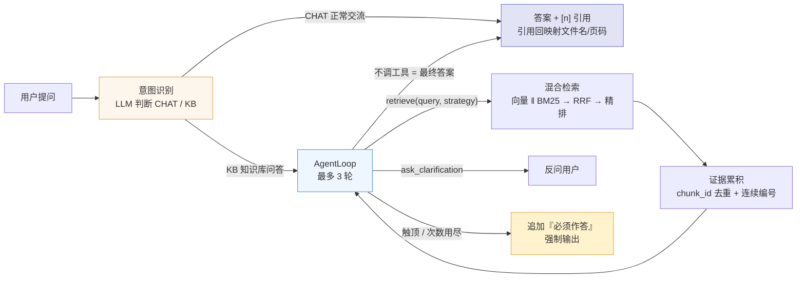

# Qwen 本地领域知识库系统

> 面向领域文档的**智能体问答系统**：把「检索怎么做」交给 **本地部署的 Qwen3-8B** 逐轮决策 —— 判断该不该检索、把口语改写成规范 query、选择向量 / BM25 / 融合 / 精排中的哪条链路、证据是否足够，最多 **3 轮**收敛并给出可溯源的答案。
>
> 本目录由 `agent/` 整体迁移而来，唯一变化是**驱动决策的 LLM**：从 DeepSeek 远端 API 换成本机 Ollama 中的 Qwen3。检索、融合、精排、生成、引用、入库、准入与决策可视化全部保留。

***

## 与 agent 版的差异

| <br /> | agent（DeepSeek）               | qwen\_rag（本版）                            |
| ------ | ----------------------------- | ---------------------------------------- |
| 模型来源   | DeepSeek 云端 API，需 API Key     | 本机 Ollama，**完全离线、零 API 费用**              |
| 调用协议   | OpenAI 兼容 `/chat/completions` | Ollama 原生 `/api/chat`                    |
| 思考模式   | 无                             | `think=false`（Qwen3 默认思考会让单轮决策慢约 8-10 倍） |
| 上下文窗口  | 由服务端决定                        | 显式 `num_ctx=8192`（证据上限 6000 字，4096 不够）   |
| 多模态    | 支持图片（切换多模态模型）                 | **不支持**（Qwen3-8B 为纯文本模型，图片入口已下线）         |
| 默认端口   | 8003 / 5173                   | **8004 / 5174**（四版端口全错开，可同时运行）          |

***

## 功能特性

- **智能问答（Agent 自主决策）**：进入决策循环前先由 LLM 做**意图识别**——正常交流（CHAT）直接作答、不检索；知识库问答（KB）则强制先检索再作答。循环内每轮只做一件事：调用 `retrieve`、调用 `ask_clarification`，或直接输出最终答案。指代不明先反问；证据不足如实拒答，不臆造。

- **决策轨迹可视化**：右侧面板按轮次展示时间线（行动类型、改写后的 query、所选策略、命中片段、耗时），片段行复用检索详情的视觉；历史会话可从落库轨迹还原。

- **三轮硬约束**：单问题最多 3 轮决策，第 3 轮必须直接作答；未知工具、检索次数用尽、空 query 也会立即收敛，不存在无限循环。

- **引用可溯源**：跨轮证据按 `chunk_id` 去重、编号连续，答案中的 `[n]` 精确映射回「文件名 + 页码」。

- **多知识库管理**：新建 / 编辑（名称、简介、分块策略）/ 启停 / 删除，知识库之间彼此隔离。

- **文档入库**：pdf / docx / txt / md 上传，解析、分块并建立向量与 BM25 双索引，支持在线预览。

- **检索策略调试**：在线对比 `vector` / `bm25` / `hybrid` / `hybrid_rerank` 四档的召回结果与耗时分解。

- **日志与深色模式**：检索日志、系统日志两个标签页；左下角切换浅色 / 深色科技风，偏好存于 localStorage。

***

## 系统架构

### 一次 Agent 问答



### 意图识别 + 三轮决策的分工

| 阶段    | LLM 的职责                                          | 系统动作                    |
| ----- | ----------------------------------------------- | ----------------------- |
| 决策前   | 意图识别：判断是正常交流（CHAT）还是知识库问答（KB），只输出一个词 | 记入轨迹（`action=intent`）；分类失败回落 KB |
| 第 1 轮 | KB：改写 query 并检索 / 歧义反问；CHAT：直接作答                | KB 的检索结果编号后回填为 tool 消息 |
| 第 2 轮 | 评估证据：足够则作答；不足则换关键词或换角度再检索（禁止完全相同 query）         | 同上，检索调用次数累计             |
| 第 3 轮 | 必须直接输出最终回答，禁止再调用任何工具                            | 循环到顶后收敛                 |

保底机制：

1. `for` 循环封顶 `MAX_DECISION_ROUNDS`（默认 3）；
2. 「不调工具即输出 content」——该 content 直接作为最终答案（方案 A，不再二次生成）；
3. 触顶或异常后追加 `FORCE_ANSWER_INSTRUCTION` 再请求一次，强制产出答案；
4. KB 首轮未检索却直接作答：正文先缓存不推送 → 追加系统拦截指令重决策 → 仍拒绝则由系统兜底检索；
5. 意图分类异常/无法解析时回落 KB（宁可多检索一次，也不放过幻觉）。

***

## 技术栈

### 后端

- Web 框架：FastAPI + Uvicorn

- 数据访问：SQLAlchemy 2.0（async）+ aiomysql + Alembic，数据库 MySQL

- 数据模型：Pydantic v2 / pydantic-settings

- 异步任务：Celery（broker 与结果后端均为 Redis，可选）

- 对象存储：local（默认，落本地 `storage/`）或 MinIO

- 可观测：loguru 日志 + prometheus-client 指标

### 前端

- 框架：React 18 + Vite 5

- 路由 / 状态：React Router 6 + Zustand 4

- 请求 / 渲染：axios + marked

- 样式：自写 CSS（复用 `theme.css` 的 CSS 变量与深色主题），不引入 UI 组件库

### 检索与模型

- 稠密召回：BAAI/bge-large-zh-v1.5（sentence-transformers，本地推理，1024 维）

- 稀疏召回：BM25Okapi + jieba 分词

- 融合：RRF（k=60）；精排：BAAI/bge-reranker-v2-m3 交叉编码器

- 向量库：Chroma（本地持久化）

- **决策与生成：本地 Qwen3-8B（Ollama 原生** **`/api/chat`，`think=false`，`temperature=0`）**

### Agent 实现

- 不依赖 LangChain Agent / 自建 ReAct 文本协议，直接用 Ollama 原生工具调用；

- 单轮决策 → 执行 → 回填 → 下一轮，状态显式保存在 `AgentState`；

- 检索与 LLM 调用均为阻塞操作，统一在线程池执行；

- `src/generation/llm.py` 负责协议转换：OpenAI 风格消息 ↔ Ollama 原生消息（tool\_calls 的 arguments 需为对象，tool 消息按 id 映射回 `tool_name`）。

***

## 目录结构

```
qwen_rag/
├── backend/
│   ├── alembic/                数据库迁移脚本（versions/*）
│   ├── scripts/
│   │   ├── init_db.py          建库 + 建表（默认走 Alembic）
│   │   └── seed_data.py        预置「法律领域」知识库并导入语料
│   ├── src/
│   │   ├── agent/              ⭐ 本版新增：调度层
│   │   │   ├── loop.py         AgentLoop：逐轮决策 + 三档收敛保底
│   │   │   ├── state.py        消息 / 证据 / 轨迹状态（chunk_id 去重、连续编号）
│   │   │   ├── tools.py        工具层：策略开关映射 + 复用 retrieval_service
│   │   │   └── prompts.py      AGENT_SYSTEM / TOOL_SCHEMAS / 兜底指令
│   │   ├── api/                main.py（入口）、v1/（agent / chat / kb / document / retrieval / log）
│   │   ├── core/               config.py（含 agent 分组）、logging.py
│   │   ├── db/                 引擎与会话、models/（ORM）
│   │   ├── ingest/             解析、分块、索引写入
│   │   ├── retrieval/          向量召回、BM25、RRF、精排、链路组装
│   │   ├── generation/         Prompt 组装、本地 Qwen 调用（Ollama 原生协议）、引用解析
│   │   ├── services/           agent_service（门面）、chat_service（会话/消息/SSE）、kb / document / ingest / retrieval
│   │   ├── schemas/            请求 / 响应模型（agent.py 为智能问答契约）
│   │   ├── tasks/              Celery 应用与文档解析任务
│   │   └── utils/              存储抽象、Redis、MinIO 客户端
│   ├── tests/                  pytest 冒烟测试
│   ├── requirements.txt
│   ├── .env.example            环境变量模板
│   ├── Dockerfile
│   └── docker-compose.yml      MySQL + Redis + MinIO + 后端
└── frontend/
    ├── src/
    │   ├── api/                axios 封装：agent / chat / kb / document / log
    │   ├── components/         DecisionTrace（决策轨迹）、RetrievalDetail、ChatMessage、CitationCard、StrategyBuilder、MainLayout
    │   ├── pages/              AgentChat（智能问答）/ KnowledgeBase / RetrievalStrategy / Logs
    │   ├── stores/             Zustand：kb / chat / agent
    │   ├── assets/             theme.css（主题与深色变量）
    │   ├── styles/             app.css（布局与组件样式）
    │   ├── router.jsx
    │   └── main.jsx
    ├── index.html
    ├── package.json
    └── vite.config.js
```

前端固定四个页面：**智能问答 / 知识库 / 检索策略 / 日志**，无登录页与设置页。

***

## 快速开始

### 环境要求

- Python 3.11.9（Windows x64）

- Node.js 18+ 与 npm

- **Ollama**（本机已安装，且已 `ollama pull qwen3:8b`；8 GB 显存可跑 q4 量化）

- MySQL 8（必需）；Redis、MinIO 可选

- Docker 可选（一键启动基础设施）

### 0. 准备本地 Qwen

```powershell
# 启动 Ollama 服务（保持窗口常驻；Windows 托盘版若启动失败，用命令行方式最稳）
ollama serve

# 另开一个窗口确认模型已就位
ollama list          # 应能看到 qwen3:8b
# 若没有：ollama pull qwen3:8b
```

> 模型存放在 `OLLAMA_MODELS` 指定的目录（本机为 `D:\98429\ollama\models`）。
> 不需要 API Key，也不需要联网。

### 后端

```powershell
cd qwen_rag\backend

# 1. 创建虚拟环境并安装依赖
uv venv --python 3.11 .venv
uv pip install --python .venv\Scripts\python.exe -r requirements.txt
# 或：python -m venv .venv && .\.venv\Scripts\Activate.ps1 && pip install -r requirements.txt

# 2. 准备配置：复制模板
Copy-Item .env.example .env
#   RAG_LLM__BASE_URL     本机 Ollama 地址（默认 http://127.0.0.1:11434）
#   RAG_LLM__MODEL        本机已下载的模型（默认 qwen3:8b）
#   RAG_DATABASE__URL     本机 MySQL 连接串
#   RAG_EMBEDDING__CACHE_DIR  仓库根 .hf-cache 的绝对路径
#   RAG_RESOURCE_DIR      预置语料目录（默认指向 product/resource）
#   RAG_API__PORT         本版用 8004（demo 8001 / product 8002 / agent 8003）

# 3. 启动 MySQL（本机未运行时可用 Docker 只拉起数据库）
docker compose up -d mysql redis minio

# 4. 初始化数据库并灌入预置语料
python scripts\init_db.py
python scripts\seed_data.py

# 5. 自检与启动
python -m src.core.config      # 打印配置（LLM=ollama/qwen3:8b@...）
python -m src.api.main         # 默认 http://127.0.0.1:8004
```

首次启动会在后台线程预热向量与精排模型（CPU 下精排加载约 20 秒），期间 `/health` 返回 `warmed_up=false`。

> 本目录未自带 `.venv` 时，可直接复用 `product/backend/.venv` 的 Python 解释器：
> `..\..\product\backend\.venv\Scripts\python.exe -m src.api.main`

### 前端

```powershell
cd qwen_rag\frontend
npm install
npm run dev
```

### 访问地址

- 前端：http://localhost:5174（默认落到 `/agent` 智能问答页）

- 后端 API：http://localhost:8004（业务前缀 `/api/v1`）

- 交互式文档：<http://localhost:8004/docs>

> 四版端口全部错开，可同时运行：`demo/` 8001 / 5171、`product/` 8002 / 5172、`agent/` 8003 / 5173、`qwen_rag/` 8004 / 5174。

***

## 配置说明

命名规则：`RAG_<分组>__<字段>`（双下划线表示嵌套），默认值在 `src/core/config.py`，可被 `.env` 覆盖。

### Agent 分组

| 环境变量                             | 默认值        | 说明                  |
| -------------------------------- | ---------- | ------------------- |
| `RAG_AGENT__MAX_DECISION_ROUNDS` | `3`        | 单问题最多决策轮数（1\~5，硬约束） |
| `RAG_AGENT__MODEL`               | `qwen3:8b` | 决策用模型（本地 Ollama）    |
| `RAG_AGENT__TEMPERATURE`         | `0.0`      | 决策需稳定，默认 0          |
| `RAG_AGENT__MAX_TOKENS`          | `1024`     | 单轮决策输出上限            |
| `RAG_AGENT__MAX_RETRIEVE_CALLS`  | `3`        | 检索工具最多调用次数，用尽即强制作答  |

### LLM 分组（本地 Qwen）

| 环境变量                | 默认值                      | 说明                            |
| ------------------- | ------------------------ | ----------------------------- |
| `RAG_LLM__PROVIDER` | `ollama`                 | 固定为本地 Ollama                  |
| `RAG_LLM__BASE_URL` | `http://127.0.0.1:11434` | Ollama 服务地址（原生 API，无 `/v1`）   |
| `RAG_LLM__MODEL`    | `qwen3:8b`               | 已下载的模型名                       |
| `RAG_LLM__THINK`    | `false`                  | Qwen3 thinking 开关；开启会显著拖慢每轮决策 |
| `RAG_LLM__NUM_CTX`  | `8192`                   | 上下文窗口；证据上限 6000 字，4096 不够     |
| `RAG_LLM__API_KEY`  | 空                        | 本地部署不需要；仅远端兼容接口才需要            |

### 复用字段（与 product / agent 相同）

- `RAG_DATABASE__URL`：MySQL 异步连接串；`RAG_REDIS__URL`：Redis（Celery）

- `RAG_STORAGE__TYPE`：`local` | `minio`

- `RAG_EMBEDDING__OFFLINE` / `RAG_EMBEDDING__CACHE_DIR`：离线模式与模型缓存

- `RAG_RESOURCE_DIR`：种子语料目录（只读引用，不复制原文）

- 检索链路参数（`DENSE_TOP_K=50` / `SPARSE_TOP_K=50` / `TOP_K=20` / `RRF_K=60` / `RERANK__TOP_K=5` / `CONTEXT_MAX_CHARS=6000`）一般无需修改

安全提示：`.env` 已被 `qwen_rag/.gitignore` 忽略；本地版本身不含任何密钥。

***

## 主要 API 一览

业务接口统一挂载在 `/api/v1` 下。

### 智能问答

| 方法   | 路径                   | 用途                                             |
| ---- | -------------------- | ---------------------------------------------- |
| POST | `/agent/chat`        | 智能问答（非流式），返回答案、引用、决策轨迹、轮数                      |
| POST | `/agent/chat/stream` | 智能问答（SSE）：`meta → agent_step×N → delta → done` |

### 会话

| 方法     | 路径                                          | 用途                            |
| ------ | ------------------------------------------- | ----------------------------- |
| GET    | `/conversations`                            | 会话列表（可按 `kb_id` 过滤）           |
| GET    | `/conversations/{conversation_id}/messages` | 会话消息（含 `latency.agent_trace`） |
| DELETE | `/conversations/{conversation_id}`          | 删除会话                          |
| DELETE | `/conversations`                            | 清空会话（可按 `kb_id` 过滤）           |

### 知识库 / 文档 / 检索

| 方法                 | 路径                         | 用途                          |
| ------------------ | -------------------------- | --------------------------- |
| GET / POST         | `/kb`                      | 知识库列表 / 新建                  |
| GET / PUT / DELETE | `/kb/{kb_id}`              | 详情 / 更新 / 删除                |
| PATCH              | `/kb/{kb_id}/strategies`   | 更新知识库默认检索构建块                |
| POST / GET         | `/kb/{kb_id}/documents`    | 上传文档 / 文档列表                 |
| GET / DELETE       | `/documents/{doc_id}`      | 文档详情 / 删除                   |
| GET                | `/documents/{doc_id}/file` | 预览或下载原文（`download=true` 下载） |
| POST               | `/kb/{kb_id}/retrieve`     | 检索调试（只检索不生成，可指定四档策略）        |

### 日志与服务

| 方法   | 路径                | 用途                           |
| ---- | ----------------- | ---------------------------- |
| GET  | `/logs/retrieval` | 检索日志（分页，可按 `kb_id` 过滤）       |
| GET  | `/logs/system`    | 系统日志（`logs/app.log` 尾部）      |
| GET  | `/health`         | 健康检查（含 `warmed_up`、Redis 状态） |
| POST | `/warmup`         | 手动触发热身                       |
| GET  | `/config`         | 当前生效配置（密钥脱敏）                 |
| GET  | `/metrics`        | Prometheus 指标                |

***

## 决策轨迹与流式契约

### SSE 事件顺序

```
meta           { conversation_id, agent: true }
agent_step ×N  { step }        # 先一条 action=intent（round=0），再按决策轮次升序
delta          { delta }       # 最终答案正文，按 token 分批推送
done           { response }    # 完整响应对象，与 /agent/chat 一致
```

### 单轮 `agent_step` 结构

```json
{
  "round": 2,
  "action": "retrieve",
  "tool": "retrieve",
  "args": {"query": "施工许可证 申领条件", "strategy": "hybrid_rerank"},
  "result_count": 5,
  "docs": [{"chunk_id": "...", "rank": 1, "source": "...", "page": 3, "score": 0.99}],
  "strategy": "hybrid_rerank",
  "stats": {"dense": 50, "sparse": 50, "overlap": 31, "merged": 63, "reranked": 5},
  "llm_usage": {"prompt_tokens": 0, "completion_tokens": 0, "total_tokens": 0},
  "elapsed_ms": 812
}
```

`action` 取值：`intent`（意图识别，`args.intent` 为 `chat` / `kb`）、`retrieve`（检索）、`ask_clarification`（反问）、`answer`（直接作答）、`force_answer`（强制作答）。

### 落库与回看

轨迹随 `Message.latency` 一起落库（`latency.agent_trace`），不额外建表；历史会话读取消息时由前端据此还原时间线。

***

## 与 demo / product / agent 的关系

| <br /> | demo（验证版）             | product（产品版）         | agent（云端 LLM）        | qwen\_rag（本版）           |
| ------ | --------------------- | -------------------- | -------------------- | ----------------------- |
| 定位     | 验证混合检索 + Rerank 链路与效果 | 多知识库、多轮对话、可观测、异步入库   | 检索决策交给 DeepSeek 逐轮完成 | 检索决策交给**本地 Qwen3**，离线可跑 |
| 检索驱动   | 固定链路 + 四档策略对比         | 知识库固定策略配置            | **LLM 逐轮决策**         | **LLM 逐轮决策**（同 agent）   |
| 最终答案   | PromptBuilder + 固定生成  | 同左                   | Agent 直接产出（方案 A）     | Agent 直接产出（方案 A）        |
| 模型位置   | 云端                    | 云端                   | DeepSeek 云端 API      | **本机 Ollama**           |
| 前端     | Streamlit             | Vue 3 + Element Plus | React 18 + Vite      | React 18 + Vite         |
| 端口     | 8001 / 5171           | 8002 / 5172          | 8003 / 5173          | 8004 / 5174             |
| 决策上限   | —                     | —                    | 最多 3 轮，第 3 轮强制作答     | 同上                      |

设计文档见 [`docs/项目迁移.md`](../docs/项目迁移.md)，执行规格见 [`docs/spec.md`](../docs/spec.md)；本版沿用 agent 版的调度设计。

***

## 评估方案

本版**不含评估代码**，评估口径以文档形式固化，便于复跑与答辩，详见 [`docs/项目迁移.md`](../docs/项目迁移.md) [§10](../docs/项目迁移.md)。

| 类别              | 指标                                                               | 说明                                                   |
| --------------- | ---------------------------------------------------------------- | ---------------------------------------------------- |
| 程序化（零 token）    | 路由准确率、chitchat 正确拦截率、knowledge 正确检索率、工具调用成功率、平均决策轮数、3 轮触顶率、重复检索率 | 解析 `agent_trace` 与标注意图对比，全量跑                         |
| 检索类（沿用）         | 证据 Recall\@5 / MRR                                               | 说明"链路没被 Agent 拖垮"                                    |
| LLM 裁判（耗 token） | `faithfulness`、`answer_relevancy`、`task_completion`              | 前两项沿用既有裁判；`task_completion` 为本版新增（1\~5 分，判定是否真正解决提问） |

测试集建议 80 条，按「闲聊（20）/ 单跳知识（25）/ 多跳复合（20）/ 需澄清（15）」四层标注意图与 `gold_chunks`；裁判提示词、评分量程与汇总口径均在上述文档中给出。

***

## 说明与限制

- 单用户、无认证：没有登录页与鉴权中间件，接口可直接访问。

- 无评估代码：评估口径见文档，不随仓库提供测试集与脚本。

- **不支持图片问答**：本地 `qwen3:8b` 为纯文本模型；如需多模态，可在 Ollama 拉取 Qwen-VL 系列后扩展（需重新接入图像消息块）。

- Redis 可选：Redis 未运行时问答不受影响；仅上传文档后的异步解析会降级为线程池内同步入库。

- 检索与 LLM 调用为阻塞操作，均在线程池执行，避免阻塞事件循环。

- 首次运行需联网或已备好本地模型缓存（bge-large-zh-v1.5、bge-reranker-v2-m3）；`RAG_EMBEDDING__OFFLINE=true` 时只用本地缓存。

- 预置知识库「法律领域」的语料为只读引用，入库不复制、不改写原文件。

- `.env` 不入库；`indexes/`、`storage/`、`data/` 等运行产物同样被忽略。

