# 基于 LangChain 的校园 RAG 知识库系统

面向校园制度问答的独立系统。检索与生成链路基于 LangChain 构建，包含管理端、PC 用户端与移动端三个前端入口、账号体系与企业微信登录、角色权限、知识库管理、混合检索问答、引用溯源与反馈闭环。移动端是普通用户的主入口，也是企业微信登录的落地页面。阶段二在此基础上补充文档级权限、版本生命周期、条款级结构化分块、评估回归与人工转办；阶段三补齐多部门治理、精确与语义缓存、三轮深度问答、站内通知、运营看板、知识缺口与到期复核。

测试语料统一放在项目根目录的 `测试语料/` 下，包含 `测试集.pdf`、`1.pdf` 与 `2.pdf`；其中 `测试集.pdf` 属于《普通高等学校学生管理规定》等教育规章汇编。三份原始 PDF 仅用于内部测试并已加入 `.gitignore`；`问答测试_20261123/` 下的评测集、四轮结果、评分明细、评测报告与复跑脚本均已脱敏入库。

## 一、系统架构

### 1.1 总体架构

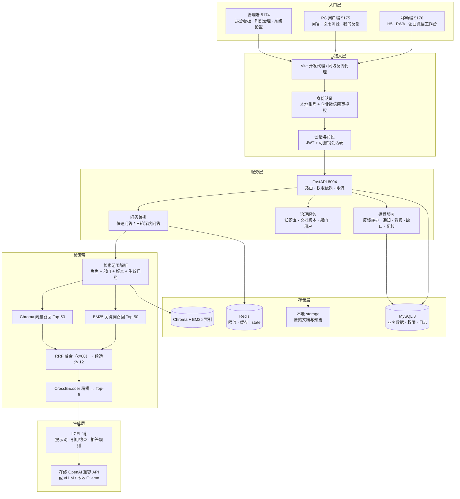

### 1.2 问答链路

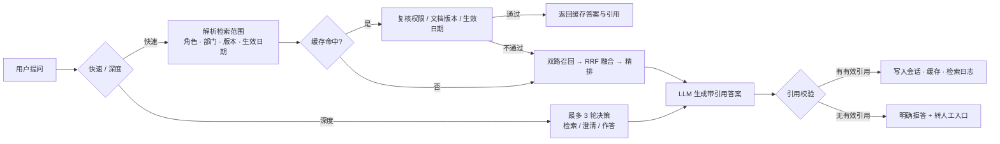

### 1.3 文档生命周期

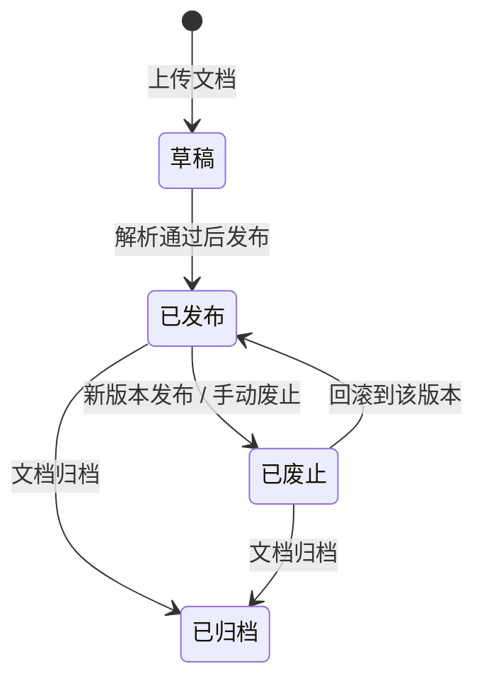

只有 `published` 且处于生效期内的版本参与召回；旧版本、未来生效版本、已废止与已归档文档不进入检索范围。

## 二、界面预览

> 以下 12 张截图均取自本地真实运行的管理端，问答内容为实际检索与生成结果。

<table>
  <tr>
    <td align="center"><b>运营看板</b><br />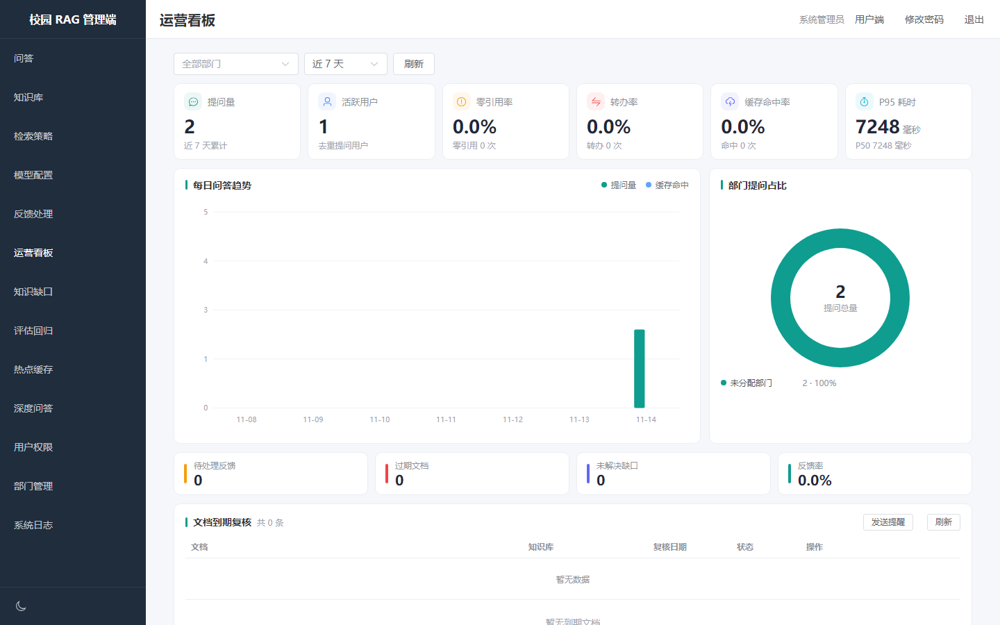</td>
    <td align="center"><b>问答 · 快速问答</b><br />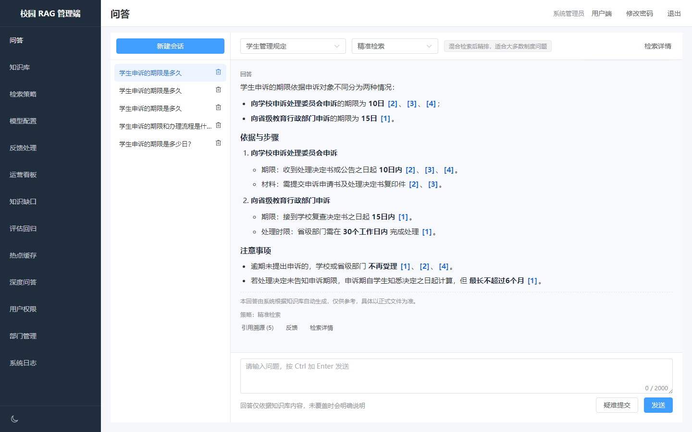</td>
  </tr>
  <tr>
    <td align="center"><b>知识库与文档版本</b><br />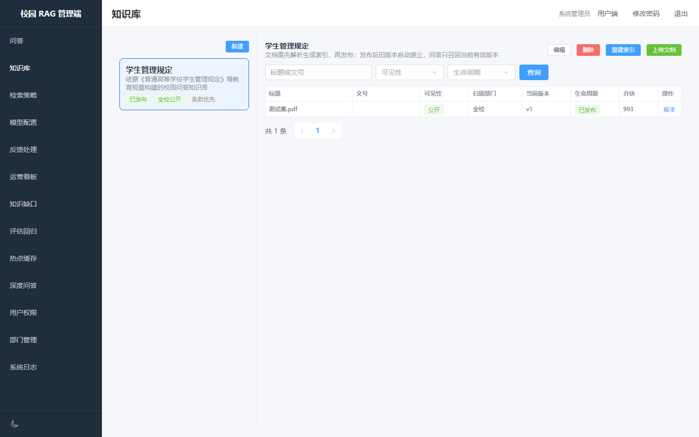</td>
    <td align="center"><b>检索策略</b><br />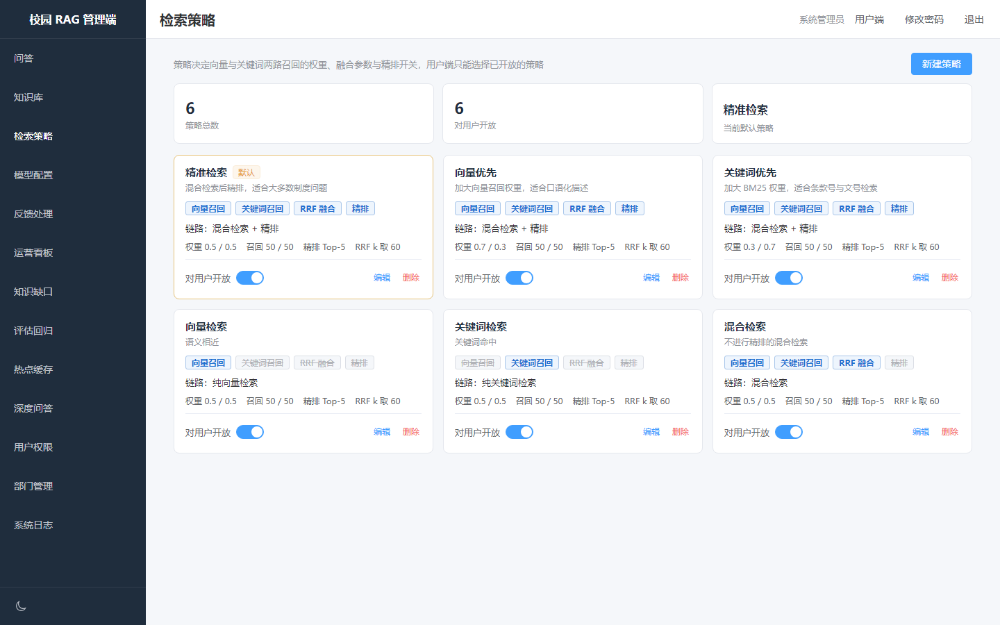</td>
  </tr>
  <tr>
    <td align="center"><b>模型配置</b><br />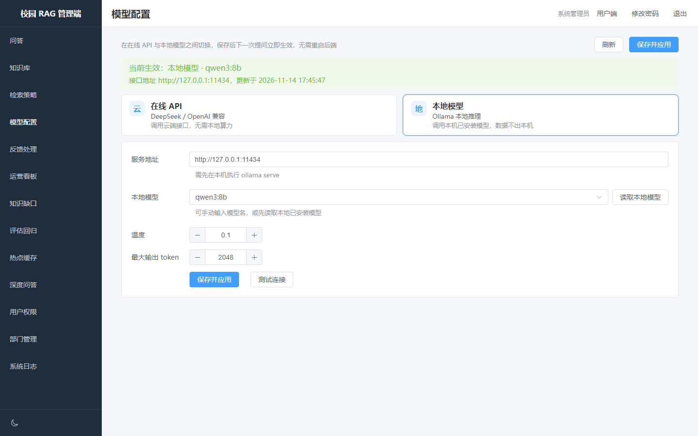</td>
    <td align="center"><b>热点缓存</b><br />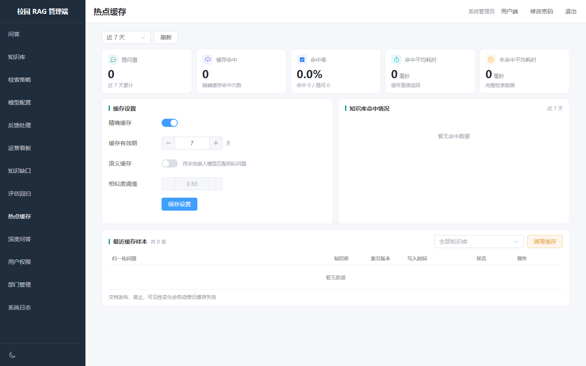</td>
  </tr>
  <tr>
    <td align="center"><b>用户权限</b><br />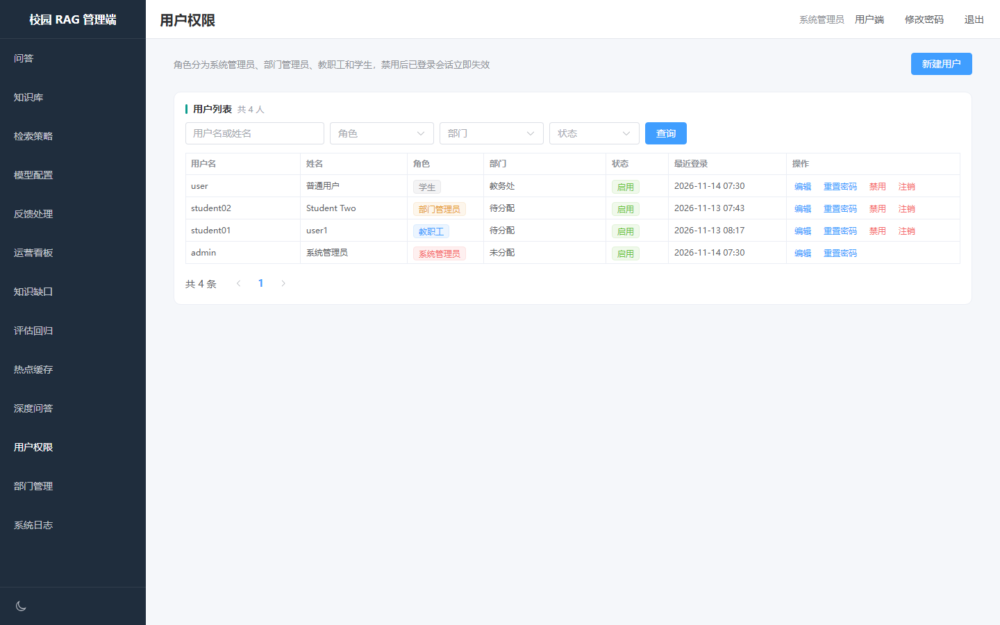</td>
    <td align="center"><b>部门管理</b><br />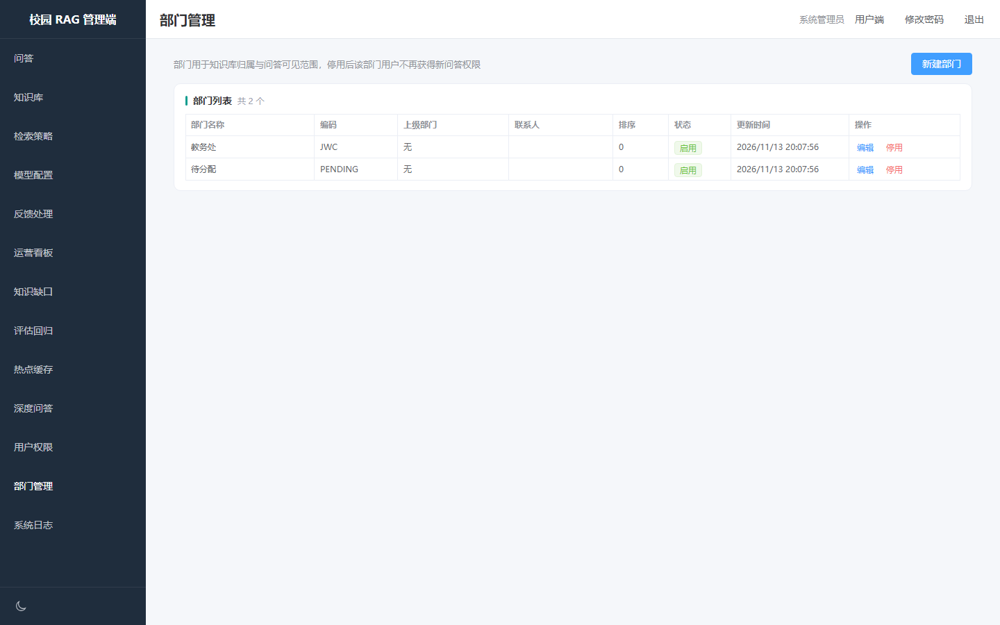</td>
  </tr>
  <tr>
    <td align="center"><b>深度问答设置</b><br />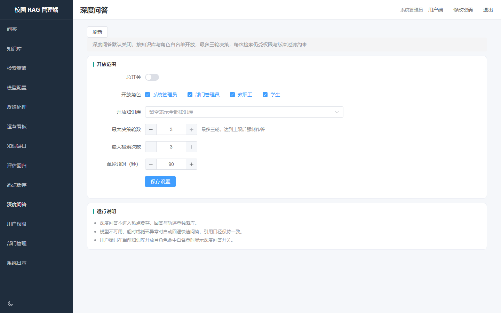</td>
    <td align="center"><b>评估回归</b><br />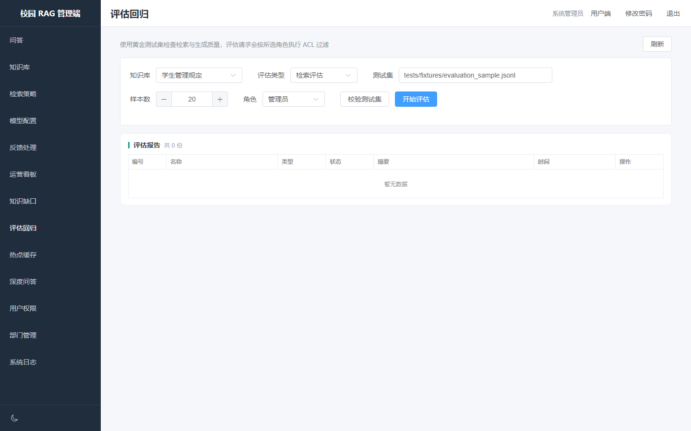</td>
  </tr>
  <tr>
    <td align="center"><b>系统日志</b><br />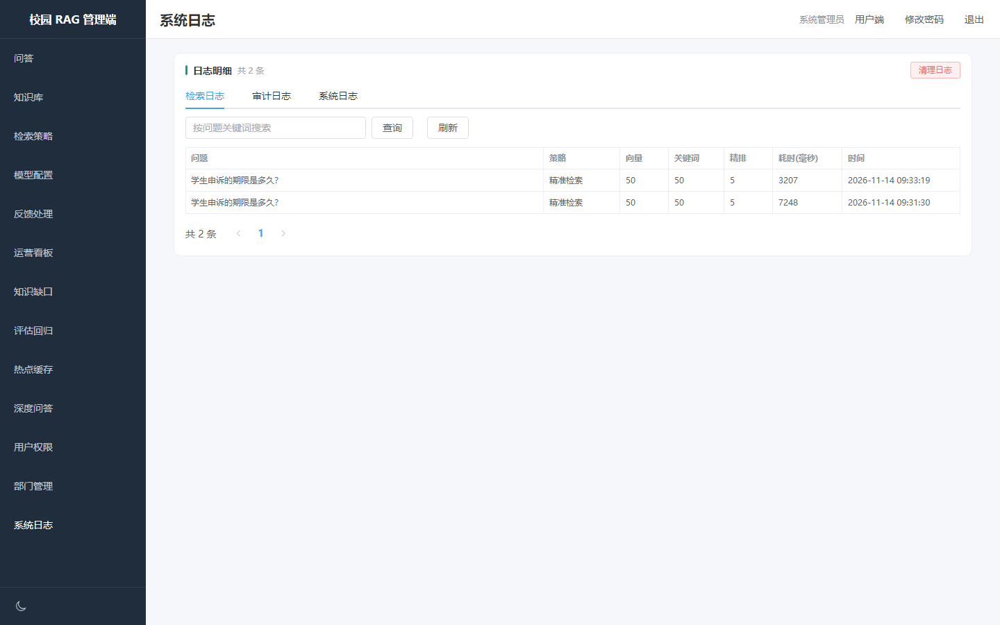</td>
    <td align="center"><b>知识缺口</b><br />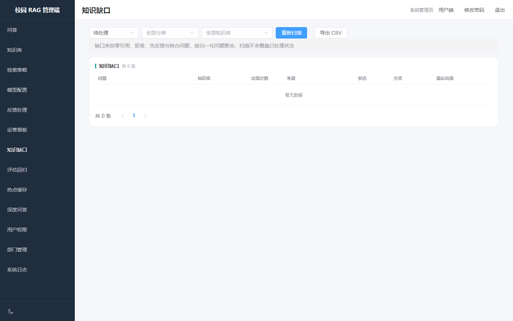</td>
  </tr>
</table>

管理端共 13 个页面：问答、知识库、检索策略、模型配置、反馈处理、运营看板、知识缺口、评估回归、热点缓存、深度问答、用户权限、部门管理、系统日志，上图展示其中 12 个。用户端与移动端共用问答与我的反馈页面，移动端另外提供通知抽屉、引用底部抽屉与 PWA 安装能力。

## 三、技术栈

| 层次 | 组件 |
| --- | --- |
| 后端 | FastAPI、Uvicorn、SQLAlchemy 2 异步 ORM、Alembic |
| 数据库 | MySQL 8 |
| 认证 | bcrypt、JWT、服务端可撤销会话表 |
| 解析 | pdfplumber、python-docx，表格转 Markdown |
| 检索 | LangChain、Chroma、BM25（jieba + rank_bm25）、EnsembleRetriever、CrossEncoderReranker |
| 生成 | LCEL 链、ChatOpenAI（兼容 DeepSeek 等 OpenAI 协议服务） |
| 限流 | Redis，不可用时退化为进程内计数 |
| 定时任务 | 进程内 asyncio 日调度：文档复核提醒、缓存清理，`SCHEDULER_ENABLED` 控制开关 |
| 前端 | Vue 3、Vite、Element Plus、Pinia、Vue Router；三端同工程构建，路由 keep-alive + `onActivated` 静默刷新，支持深色模式 |

## 四、目录结构

```text
.
├── backend/                 后端服务、迁移、脚本、测试
│   ├── alembic/             数据库迁移
│   ├── scripts/             初始化、健康检查、冒烟测试、备份
│   ├── src/
│   │   ├── api/             路由与鉴权依赖
│   │   ├── core/            配置、安全、日志
│   │   ├── db/              ORM 模型与会话
│   │   ├── ingest/          LangChain 加载、切分、索引流水线
│   │   ├── retrieval/       Chroma、BM25、融合检索、精排、检索范围
│   │   ├── evaluation/      黄金测试集校验、检索与生成评估
│   │   ├── generation/      LCEL 链、提示模板、模型工厂
│   │   ├── services/        认证、问答、文档版本、反馈、设置编排
│   │   ├── schemas/         请求与响应模型
│   │   └── utils/           限流、脱敏
│   └── tests/
├── frontend/                三端前端，同一工程按 VITE_APP_MODE 构建管理端、用户端与移动端
├── 测试语料/                内部测试语料与离线评测
│   ├── 测试集.pdf 等        原始 PDF，含内部资料，已加入 .gitignore
│   └── 问答测试_20261123/   100 题评测集、四轮结果、评分明细与评测报告
├── docs/                    需求、阶段文档、评估与部署说明
│   └── images/screenshots/  README 界面截图
├── scripts/dev.ps1          本地启动脚本
├── .env.example             配置模板
└── README.md
```

## 五、环境要求

- Windows 10 及以上，PowerShell 5.1 及以上
- Python 3.11
- Node.js 18 及以上
- MySQL 8.0
- Redis 可选，未启动时限流使用进程内计数
- GPU 可选：正式上线建议 Linux + NVIDIA 显卡并部署 vLLM；开发调试用 CPU + Ollama 即可
- 定时任务默认开启：后端启动 30 秒后执行一次文档复核提醒与缓存清理，之后每 24 小时一次；`SCHEDULER_ENABLED=false` 可关闭
- 首次索引会下载嵌入模型与精排模型，默认通过 `HF_ENDPOINT=https://hf-mirror.com` 镜像下载，模型缓存放在项目内 `.hf-cache/`

端口与库名默认值：

| 项目 | 默认值 |
| --- | --- |
| 后端 | 8004 |
| 管理端 | 5174 |
| 用户端 | 5175 |
| 移动端 | 5176 |
| 数据库 | rag_campus |
| Redis 库号 | 4 |

## 六、从零启动

### 1. 准备数据库

使用本机 MySQL 8，或使用项目内 `docker-compose.yml`。

使用 compose 时端口为 3308 与 6380，需要相应修改 `.env` 中的 `MYSQL_PORT` 与 `REDIS_URL`。

数据库连接信息以 `.env` 为准，初始化脚本会自动创建 `rag_campus` 库，不会删除已有数据库。

> 注意：MySQL 在 Windows 上无法使用包含中文的数据目录。若把 MySQL 数据目录放在本项目路径下，需改用纯英文路径或使用默认安装目录。

### 2. 配置环境变量

```powershell
Copy-Item .env.example .env
```

按实际情况修改：

- `SECRET_KEY`：随机长字符串
- `MYSQL_PASSWORD`：数据库口令
- `LLM_API_KEY`：在线 API 来源使用；未配置时调用在线 API 返回 503，vLLM 与 Ollama 来源不受影响
- `ADMIN_INITIAL_PASSWORD`：可留空，留空时由初始化脚本随机生成并只显示一次
- `HF_ENDPOINT`：模型下载地址，默认使用 `https://hf-mirror.com`，能直连模型仓库时可改为 `https://huggingface.co`
- `EMBEDDING_MODEL`、`RERANKER_MODEL`：嵌入与精排模型。代码默认 `BAAI/bge-small-zh-v1.5` 与 `BAAI/bge-reranker-base`；当前 `.env` 与 `.env.example` 的精排模型为 `BAAI/bge-reranker-v2-m3`（精度更高、推理更慢）
- `RERANK_INPUT_K`：送入精排的候选条数。代码默认 20，**本项目已调为 12**：单次检索由 21.1 秒缩短到 12.4 秒（CPU、`bge-reranker-v2-m3`），引用仍是 Top-5、答案要点不变；不建议低于 8，再往下调需复测准确率
- `VECTOR_TOP_K`、`BM25_TOP_K`：无检索策略预设时的召回条数。管理端「检索策略」选中预设后以预设值为准，此时改 `.env` 不生效；实测召回 50 与 20 的检索耗时几乎相同（相差 0.2 秒），不必为提速缩小召回
- `CORS_ORIGINS`：开发环境用 Vite 代理可保持默认；三端分别部署时需包含 5174、5175、5176 或对应的正式域名
- `WECOM_ENABLED` 与企业微信配置：`WECOM_CORP_ID`、`WECOM_AGENT_ID`、`WECOM_SECRET`、`WECOM_REDIRECT_URI` 齐全且开关为 `true` 时，移动端登录页展示企业微信登录；`WECOM_REDIRECT_URI` 需与企业微信后台的网页授权回调域名一致，指向移动端 `/wecom/callback`

### 2.1 模型服务选型（vLLM 接口已就绪，暂不部署）

系统支持三种模型来源，在管理端「模型配置」页切换，保存后下一次提问立即生效，无需重启后端：

| 来源 | 定位 | 当前状态 |
| --- | --- | --- |
| 在线 API | 原有调用方式，保持默认 | 已可用，需配置 `LLM_API_KEY` |
| 本地 Ollama | 开发调试与本地演示 | 已可用 |
| vLLM 服务 | 上线预留，对接 GPU 服务器，低延迟、高并发 | 接口与配置已内置，**尚未部署服务** |

**开发调试：Ollama**

```powershell
ollama serve
ollama pull qwen3:8b
```

管理端「模型配置」选「本地模型」，服务地址填 `http://127.0.0.1:11434`，模型填 `qwen3:8b`。CPU 环境下 8B 模型首个增量约需三十秒，只适合功能验证与演示，不建议承载正式流量。

**上线预留：vLLM（待 GPU 服务器到位）**

当前环境无需部署 vLLM：相关代码、前端入口、连接测试与配置项均已就绪，等 GPU 服务器到位后按下列步骤启用即可，不需要再改代码。

在 Linux GPU 服务器（CUDA 12.1+，Python 3.10/3.11）执行：

```bash
pip install vllm

vllm serve Qwen/Qwen2.5-14B-Instruct-AWQ \
  --served-model-name qwen2.5-14b \
  --host 0.0.0.0 --port 8001 \
  --max-model-len 8192 \
  --gpu-memory-utilization 0.75 \
  --max-num-seqs 24
```

管理端「模型配置」选「vLLM 服务」，服务地址填 `http://GPU服务器IP:8001/v1`，模型名与 `--served-model-name` 保持一致。`.env` 中的 `VLLM_BASE_URL`、`VLLM_MODEL` 作为默认值，管理端保存后以数据库为准；只有 vLLM 用 `--api-key` 开启鉴权时才需要填 `VLLM_API_KEY`。

三点注意：

- 本机 8GB 显存只能跑 7B 量化模型，达不到上线要求，因此不在开发机部署；
- 检索用的嵌入与精排模型仍由后端进程加载，想让它们也走 GPU，设 `EMBEDDING_DEVICE=cuda`；
- 显存估算、并发容量、systemd 自启与验收指标见 [GPU 加速部署方案](docs/deployment/GPU加速部署方案.md)。

`.env` 已被 `.gitignore` 忽略，不要提交真实密钥。

模型缓存说明：后端启动时把 `HF_HOME` 与 `SENTENCE_TRANSFORMERS_HOME` 指向项目内 `.hf-cache/`。已下载过模型时，把对应模型目录复制到 `.hf-cache/hub/` 下即可离线复用，不必重复下载。例如复用本机已有的 `BAAI/bge-reranker-v2-m3` 时，把 `.env` 中的 `RERANKER_MODEL` 改为该模型名并保证缓存目录存在。

### 3. 初始化后端

```powershell
cd backend
python -m venv .venv
.\.venv\Scripts\python.exe -m pip install -r requirements.txt
.\.venv\Scripts\python.exe scripts\init_db.py
```

初始化脚本会完成：

1. 创建数据库（如不存在）
2. 执行 Alembic 迁移
3. 写入三条默认检索策略
4. 创建初始管理员，并打印初始密码或提示密码来自环境变量

初始管理员首次登录必须修改密码。

### 4. 启动后端

```powershell
.\.venv\Scripts\python.exe -m uvicorn src.main:app --app-dir backend --host 127.0.0.1 --port 8004
```

健康检查：

```powershell
.\.venv\Scripts\python.exe backend\scripts\health_check.py
```

### 5. 安装并启动前端

```powershell
cd frontend
npm install
npm run dev:admin
npm run dev:user
npm run dev:mobile
```

分别访问：

- 管理端：http://127.0.0.1:5174
- PC 用户端：http://127.0.0.1:5175
- 移动端：http://127.0.0.1:5176，手机浏览器或用浏览器移动模拟器访问，企业微信回调也指向该端口

前端通过 Vite 代理访问后端 `/api`，无需额外配置跨域。

也可以使用 `scripts/dev.ps1` 按服务启动：`.\scripts\dev.ps1 init` 创建虚拟环境、安装依赖并初始化数据库；`.\scripts\dev.ps1 backend`、`admin`、`user`、`mobile` 分别启动后端或单个前端。MySQL 与 Redis 需提前启动。

生产构建：

```powershell
npm run build
```

产物分别位于 `frontend/dist/admin`、`frontend/dist/user` 与 `frontend/dist/mobile`。

### 6. Linux 服务器部署

以上为 Windows 本地开发流程。部署到学校服务器（Ubuntu）请直接使用 [Linux 部署手册](docs/deployment/Linux部署手册.md)，其中提供：

- systemd 单元：[campus-rag-backend.service](docs/deployment/systemd/campus-rag-backend.service)（单 worker，随机器自启）
- Nginx 三端配置：[campus-rag.conf](docs/deployment/nginx/campus-rag.conf)（静态托管 + `/api` 反代 + SSE）
- 后端镜像：[backend/Dockerfile](backend/Dockerfile)（可选，单实例运行）
- MySQL/Redis 初始化、目录权限、升级回滚与排障清单

## 七、首次使用路径

1. 管理员登录管理端，按提示修改初始密码。
2. 进入「部门管理」维护部门层级、联系人、排序与启用状态，再进入「用户权限」创建用户，设置角色（系统管理员、部门管理员、教职工、学生）与所属部门。
3. 进入「知识库」，新建知识库并选择可见性、归属部门、责任人与复核周期。全校公开库仅系统管理员可建；部门管理员只能建本部门内部库。分块策略建议制度类文档使用 `clause`，即条款级切分。
4. 上传文档，填写标题、文号、版本号、可见性、生效日期与复核日期；可见性为「部门内部」时必须选择归属部门。
5. 在版本抽屉中执行「解析」，查看分块统计与一致性检查结果；解析会自动清洗页眉页脚与目录页、剔除表格区域避免正文重复、合并跨页表格、按目录或附件标题识别多文件分节，并显示页数、分节数、表格数与分块统计。原始 PDF 可直接上传，无需先人工拆分或转换。处理完成后再「发布」，旧版本自动废止。
6. 管理端「问答」验证引用与检索详情；用户端登录后先选择知识库，再提问。学生只能选择公开库，教职工与部门管理员可选公开库与本部门库。
7. 无依据或拒答时可点击「转人工」，生成 `TR-YYYYMMDD-0001` 转办单并自动分配到知识库归属部门。
8. 部门管理员在「反馈处理」受理、回复、办结或退回；用户在「我的反馈」查看处理进度、首次响应时间与回复，并在通知中接收状态变更。
9. 管理员在「评估回归」校验测试集、运行检索或生成评估并查看报告。
10. 管理员在「热点缓存」查看命中率、调整有效期、开关精确与语义缓存、清理缓存与标记疑似误答；在「深度问答」按知识库与角色开启三轮决策。
11. 管理员与部门管理员在「运营看板」查看提问量、零引用率、转办率、缓存命中率、P95、部门对比与文档到期复核；在「知识缺口」汇总零引用、拒答、负反馈与转办问题并导出 CSV。
12. 配置企业微信后，用户在企业微信工作台打开移动端，登录页显示「企业微信登录」，静默授权后按企业微信成员账号匹配同名站内用户名并自动绑定；未匹配到账号时提示联系管理员开通。

角色可见范围：学生只看公开知识库；教职工与部门管理员可访问公开知识库与本部门知识库；系统管理员可管理全部知识库，但正常问答仍只返回当前有效、已发布的文档。「仅管理员」文档不进入任何角色的问答结果，只能在管理端预览。知识库停用或归属部门停用后不再对用户展示，既有会话可读但新问答不可用。

### 界面与交互

- 深色模式：管理端左下角月亮按钮、PC 用户端左下角月亮按钮、移动端顶部通知左侧月亮图标；主题写入本地存储，三端刷新后保持。
- 三端路由对页面启用 keep-alive；从其他页面返回时通过 `onActivated` 静默刷新数据，不重复整页加载，也不打断正在输入的问答内容。
- 通知每 60 秒刷新未读数；反馈与转办状态变更、文档到期提醒统一写入站内通知，通知失败不影响业务提交。
- 管理端「系统日志」支持按类型查看检索日志、审计日志与系统日志，并提供日志清理；「用户权限」支持禁用、重置密码与注销账号。

### 移动端适配

- 移动端是独立构建与独立路由，开发地址 5176，产物 `frontend/dist/mobile`，与 PC 用户端共用登录、问答、反馈与通知接口。
- 页面采用移动优先布局：顶部为标题、通知与设置，底部固定「问答」「我的反馈」两个标签，内容区按 `100dvh` 与 `env(safe-area-inset-bottom)` 适配刘海屏与底部手势区。
- 窄屏断点为 768 像素；会话列表改为侧滑抽屉，引用详情改为底部抽屉，检索详情改为全屏覆盖，主要按钮保持不小于 44 像素的触控高度。
- 回答正文在窄屏下为 14 像素、行高 1.6，标题依次为 18、16、15 像素，引用卡片为 13 像素；360 至 430 像素宽度下正文与表格不产生横向滚动，表格超宽时在卡片内横向滚动。
- 支持停止生成、回到底部、切换知识库清空上下文、深度问答与决策轨迹；通知抽屉在移动端全屏展示。
- 企业微信网页授权回调指向移动端 `/wecom/callback`，登录成功后进入移动端问答页；桌面端布局与字号不受移动端样式影响。
- PC 用户端登录页展示移动端二维码，地址优先读取 `VITE_MOBILE_URL`，未配置时用当前主机加 5176；Vite 开发服务监听所有网卡，手机连同一局域网即可扫码访问。
- 移动端构建带 Manifest 与 Service Worker，可添加到主屏幕；首次访问后离线可打开应用外壳，顶部提示离线状态，问答接口不做缓存。

## 八、接口概览

所有接口以 `/api/v1` 为前缀，除登录、企业微信登录与健康检查外均需登录。

| 分组 | 路径 | 说明 |
| --- | --- | --- |
| 认证 | `/auth/login`、`/auth/logout`、`/auth/me`、`/auth/change-password` | 统一登录与改密 |
| 企业微信 | `/auth/wecom/status`、`/auth/wecom/authorize`、`/auth/wecom/callback` | 唯一的外部身份接入方式；未启用时状态接口返回 `enabled=false`，回调校验一次性 state |
| 问答 | `/chat/stream`、`/chat/capabilities` | SSE 流式问答；`mode` 支持 fast 与 deep，检索范围由登录态解析 |
| 会话 | `/conversations`、`/conversations/{id}/messages` | 会话归属隔离 |
| 知识库 | `/knowledge-bases`、`/kb`、`/kb/{id}/documents`、`/kb/{id}/rebuild` | 用户端按角色返回可用库；管理端按部门范围；写操作需文档管理权限 |
| 文档治理 | `/admin/documents`、`/admin/documents/{id}/versions`、`/admin/versions/{id}/parse\|publish\|repeal\|rollback` | 文档与版本生命周期；部门管理员仅限本部门 |
| 文档预览 | `/documents/{id}/preview`、`/admin/documents/{id}/preview` | 按 ACL 校验，越权返回 404 |
| 部门 | `/admin/departments` | 管理员可写，管理员与部门管理员可读；支持层级、排序与停用，管理端「部门管理」页面维护 |
| 策略 | `/strategies`、`/admin/strategies` | 用户只能读取已开放策略 |
| 反馈 | `/feedback`、`/feedback/transfer`、`/feedback/mine`、`/admin/feedback` | 用户提交、转人工与查看本人记录，管理员处理 |
| 通知 | `/notifications`、`/notifications/{id}`、`/notifications/read-all` | 反馈与转办状态变更、文档复核提醒的站内通知 |
| 缓存 | `/admin/cache/settings`、`/admin/cache/stats`、`/admin/cache/clear`、`/admin/cache/samples`、`/admin/cache/samples/flag` | 仅管理员；精确与语义缓存设置、命中统计、清理与误答标记 |
| 深度问答 | `/admin/agent/settings` | 仅管理员；按知识库与角色开放，最多三轮决策 |
| 运营看板 | `/admin/dashboard/summary`、`/trends`、`/departments` | 管理员看全部，部门管理员看本部门 |
| 知识缺口 | `/admin/gaps`、`/admin/gaps/scan`、`/admin/gaps/{id}`、`/admin/gaps/export` | 汇总零引用、拒答、负反馈与转办问题，支持状态更新与导出 |
| 文档复核 | `/admin/review/due`、`/admin/review/{id}/action`、`/admin/review/notify` | 到期清单、继续有效、发起修订、废止与站内提醒 |
| 评估 | `/admin/evaluation/reports`、`/validate`、`/run` | 管理员运行，管理员与部门管理员查看 |
| 用户 | `/admin/users`、`/admin/users/{id}/close` | 管理员创建、改角色与部门、禁用、重置密码与注销账号 |
| 日志 | `/admin/logs/retrieval`、`/admin/logs/audit`、`/admin/logs/system`、`/admin/logs/clear` | 仅管理员；查看与清理日志 |
| 模型 | `/admin/model-config`、`/admin/model-config/ollama-models`、`/admin/model-config/test` | 仅管理员；在线 API、vLLM 服务与本地 Ollama 三模式切换，密钥只从环境变量读取 |
| 健康检查 | `/health` | 不在 `/api/v1` 前缀下；含数据库与索引一致性 |

错误语义：未登录 401，无权限 403，资源不存在或不属于当前用户 404，版本冲突或重复上传 409，参数不合法 422，触发限流 429，索引未就绪 503。

## 九、验收与测试

### 9.1 问答质量评测（2026-11 基线）

离线评测集位于 `测试语料/问答测试_20261123/`，共 100 题：KB3 与 KB4 各 50 题，题型配比为口语泛化 50、多跳推理 25、规范表述 25。所有题目走统一链路：管理员账号、精准检索（`strategy_id=1`，向量 + BM25 混合召回后交叉编码精排）、快速问答模式、关闭缓存。

四轮结果对比（三档判分：正确 1.0、部分正确 0.5、错误或拒答 0.0）：

| 轮次 | 模型与索引状态 | 总体 | KB3 | KB4 | 口语 | 多跳 | 规范 |
| --- | --- | --- | --- | --- | --- | --- | --- |
| 基线 | qwen3:8b，修复前索引 | 73.0% | 85.0% | 61.0% | 76.0% | 68.0% | 72.0% |
| 解析与切分修复 | qwen3:8b，合并硬换行、表格、条号上下文 | 79.0% | 86.0% | 72.0% | 82.0% | 62.0% | 90.0% |
| 附件去重 | qwen3:8b，章节级去重后 361 块 | 82.5% | 88.0% | 77.0% | 87.0% | 66.0% | 90.0% |
| 强模型对照 | deepseek-chat API，同索引 | 96.5% | 99.0% | 94.0% | 97.0% | 92.0% | 100.0% |

API 轮判定分布：正确 94、部分正确 5、错误或拒答 1，平均 13.1 秒/题。剩余失分集中在多跳题的最终数值聚合（4 题）与一处合并单元格解析缺陷（1 题），逐条说明见评测报告。表内「361 块」为去重当轮规模，当前索引经合并单元格修复后重建为 362 块（doc5 251 / doc6 111）。

产物清单：

| 文件 | 说明 |
| --- | --- |
| `qa_kb3.jsonl`、`qa_kb4.jsonl` | 评测集，含问题、参考答案、分类与证据 |
| `校园RAG问答测试_200条模板.csv` | 题库模板，供扩充新题 |
| `results_*.jsonl` | 各轮原始回答与耗时 |
| `scores_*.json`、`评分明细_*.csv` | 各轮评分汇总与逐题明细 |
| `recall_*.json` | 检索级验证：证据是否进入候选与最终 top5 |
| `dup_analysis.json` | 重复附件量化数据 |
| `Ollama本地模型问答测试报告.md` | 本地模型测试全流程与失分结构 |
| `评分与模型选型报告.md` | 评分口径、剩余失分、模型选型与落地验收标准 |
| `测试总结摘要.md` | 一页版结论 |
| `scripts/run_qa.py`、`scripts/score_answers.py` | 批量执行与判分脚本 |

复现方式（项目根目录执行，需先在管理端切换模型来源）：

```powershell
# 批量跑题，输出到测试目录；不传题号则跑全部
backend\.venv\Scripts\python.exe 测试语料\问答测试_20261123\scripts\run_qa.py results_api.jsonl

# 指定题号重跑
backend\.venv\Scripts\python.exe 测试语料\问答测试_20261123\scripts\run_qa.py results_subset.jsonl kb4-hop-001 kb4-hop-002

# 按人工复核结果汇总评分
backend\.venv\Scripts\python.exe 测试语料\问答测试_20261123\scripts\score_answers.py results_api.jsonl
```

判分脚本以 `OVERRIDES` 记录逐题扣分结论，未列出的题按 1.0 计；换用新结果文件时需同步复核该表。口径限制：样本为 100 题（95% 置信区间约 ±5 分）、单次采样、判分与答题同源，正式发布前应扩样本至 300 题以上或人工抽检 20 题校准。

### 9.2 单元测试

```powershell
backend\.venv\Scripts\python.exe -m pytest backend\tests -q
```

覆盖检索范围构造、文档可见性、知识库可见性矩阵、生命周期状态、条款切分、PDF 表格结构解析（跨页合并、合并单元格填充、单列表格降级）、评估指标、引用结构、缓存键与权限隔离、语义相似度计算、深度问答意图识别与轮数上限、看板口径、企业微信开关与授权链接，共 83 项。

### 9.3 冒烟测试

后端冒烟测试覆盖登录、上传入库、混合检索问答、引用返回、反馈提交：

```powershell
backend\.venv\Scripts\python.exe backend\scripts\smoke_test.py 管理员密码
```

### 9.4 评估模块

内置评估工具：

```powershell
cd backend
.\.venv\Scripts\python.exe -m src.evaluation.cli validate --testset tests\fixtures\evaluation_sample.jsonl
.\.venv\Scripts\python.exe -m src.evaluation.cli retrieval --testset tests\fixtures\evaluation_sample.jsonl --kb-id 3 --top-k 10
.\.venv\Scripts\python.exe -m src.evaluation.cli generation --testset tests\fixtures\evaluation_sample.jsonl --kb-id 3 --limit 20
```

### 9.5 关键验收项

- 未登录访问业务接口返回 401
- 无权角色访问管理接口返回 403，越权预览返回 404
- 学生检索不到部门内部与仅管理员文档；教职工检索不到其他部门内部文档
- 同一逻辑文档最多一个当前发布版本，旧版本与未来生效版本不被召回
- 问答返回引用列表，引用包含文件名、页码、条款号、版本号、生效日期与责任部门
- 答案下方固定展示免责声明，无依据时明确拒答并提供转人工入口
- 用户只能读取自己的会话、反馈与转办单
- 反馈与转办按状态流转，转办单记录分配部门、首次响应时间与处理时间线
- `/health` 返回数据库与索引一致性，索引不一致时状态为 degraded
- 学生只能选择公开知识库，教职工与部门管理员只能选择公开库与本部门库，越权选库返回 404
- 精确缓存按知识库、策略、权限范围与索引版本隔离，文档发布、废止、归档、可见性变化后旧键立即失效
- 语义缓存用本地嵌入模型编码问题，在相同知识库、策略、权限范围与索引版本内做余弦相似度匹配，默认关闭，可在「热点缓存」按阈值开启
- 缓存命中后重新校验用户权限、文档当前版本与生效日期，任一不满足时回源
- 深度问答先做意图识别（CHAT / KB），寒暄类问题直接作答不检索；KB 问题必须先检索，最多三轮决策与三次检索
- KB 问题首次未检索就作答会被系统拦截并要求重新决策，模型仍拒绝时由系统兜底检索一次，失败时回退快速问答并保留决策轨迹
- 移动端为独立构建，入口为 5176 与 `dist/mobile`，底部导航含问答与我的反馈，企业微信回调落在移动端
- 移动端 360 像素宽度无横向滚动，引用与历史使用抽屉，支持停止生成与回到底部
- PC 用户端登录页提供移动端二维码入口，地址取 `VITE_MOBILE_URL` 或当前局域网主机加 5176
- 移动端构建带 Web App Manifest 与 Service Worker，可添加到主屏幕，首次访问后离线可打开页面并提示联网问答
- 管理端提供独立「部门管理」页面，维护部门层级、联系人、排序与启用状态，后端校验上级部门存在且不形成循环
- 运营看板、知识缺口与文档复核按角色与部门范围统计，导出 CSV 带 BOM 可直接用 Excel 打开
- 反馈与转办状态变更、文档到期提醒写入站内通知，通知失败不影响业务提交

阶段二实施细节、验证记录与未完成项见 [docs/阶段二实施记录.md](docs/阶段二实施记录.md)；阶段三实施细节与验证记录见 [docs/阶段三实施记录.md](docs/阶段三实施记录.md)；评估口径与回归流程见 [docs/evaluation/regression_v2.md](docs/evaluation/regression_v2.md)；备份恢复见 [docs/deployment/backup.md](docs/deployment/backup.md)。

2026-11 问答质量评测的完整记录见 [Ollama本地模型问答测试报告.md](测试语料/问答测试_20261123/Ollama本地模型问答测试报告.md)、[评分与模型选型报告.md](测试语料/问答测试_20261123/评分与模型选型报告.md) 与 [测试总结摘要.md](测试语料/问答测试_20261123/测试总结摘要.md)。

## 十、常见问题

**问答接口返回 503**

模型来源为「在线 API」且 `.env` 未配置 `LLM_API_KEY` 时会出现；补齐密钥后重启后端，或切到 vLLM / 本地模型来源。

**切换到 vLLM 后连接测试失败**

先确认 vLLM 服务已启动，且能访问 `http://GPU服务器IP:8001/v1/models`；再核对「模型名称」与启动参数 `--served-model-name` 是否完全一致。若 vLLM 用 `--api-key` 开了鉴权，需在 `.env` 的 `VLLM_API_KEY` 填写同一个值。

**本地模型回答缺项或频繁拒答**

Ollama 默认上下文为 4096，而单次问答的检索上下文加输出预算约需 5500–6000 token，超出部分会被静默截断，通常丢掉排名最靠前的块。把 `OLLAMA_CONTEXT_LENGTH` 设为 8192 后重启 Ollama 即可；8GB 显存的机器建议保持 8192，再大需把 KV 缓存卸载到内存，速度明显下降。

**索引重建失败**

优先检查模型是否下载完成、网络是否可访问模型仓库、`indexes/` 是否可写。错误信息会写入文档行的错误列与 `logs/backend.log`。

**模型下载超时或很慢**

默认走 `HF_ENDPOINT=https://hf-mirror.com` 镜像。首次索引会下载嵌入模型，首次问答会下载精排模型，精排模型体积较大。可提前把模型复制到 `.hf-cache/hub/` 复用，或把 `RERANK_ENABLED` 设为 `false` 先跳过精排验证其余链路。

**登录提示失败次数过多**

同一用户名与 IP 在 10 分钟内失败 5 次会锁定。可等待锁定时间结束，或清空 Redis 库 4 中对应的 `login:fail:` 键。

**登录页没有企业微信登录按钮**

确认 `.env` 中 `WECOM_ENABLED=true`，且 `WECOM_CORP_ID`、`WECOM_AGENT_ID`、`WECOM_SECRET`、`WECOM_REDIRECT_URI` 全部填写后重启后端。`GET /api/v1/auth/wecom/status` 返回 `enabled=true` 时才会展示按钮。回调地址需与企业微信后台的可信域名一致并指向移动端 `/wecom/callback`；登录 state 存放在 Redis 库 4，10 分钟内有效。

**企业微信登录提示未绑定系统账号**

企业微信成员账号需与站内用户名一致。管理员先在「用户权限」创建同名用户，首次授权后自动写入绑定关系，后续按绑定关系登录；换绑需先删除 `auth_identities` 中对应记录。

**缓存命中率始终为 0**

先确认 `REDIS_URL` 可连接，再确认问答来自新会话首问且模式为快速问答。多轮追问、深度问答、拒答与转人工回答按设计不进入缓存。文档发布或可见性变更后索引版本递增，旧缓存不会命中。

**语义缓存没有命中**

语义缓存默认关闭，先在「热点缓存」开启并确认阈值，默认 0.85，可调范围 0.75 到 1.0。只有问题表述不同但语义接近时才走语义匹配；检索详情会显示「语义相似」百分比，精确命中的显示为「精确命中」。阈值过高容易不命中，过低可能引入误答，建议用真实问题抽样后再调整。

**MySQL 连接失败**

确认服务已启动、端口与 `.env` 一致、账号具备建库权限。MySQL 8 使用 `caching_sha2_password`，依赖中的 `cryptography` 必须安装成功。

**前端 401 后不断跳登录页**

检查后端是否正常、令牌是否过期。前端把登录态存放在 `sessionStorage`，关闭标签页后需要重新登录。

## 十一、当前阶段边界

- 已实现阶段一：认证、三端前端、角色权限、问答、引用、会话归属、反馈闭环、审计与限流。
- 已实现阶段二：文档级 ACL、文档版本与生效日期、条款级结构化分块与父子块、引用版本化、黄金测试集评估模块、人工转办、索引一致性检查与备份脚本。
- 已实现阶段三：多部门治理与知识库归属、独立移动端前端、精确与语义热点缓存、独立部门管理页面、三轮深度问答、站内通知、运营看板、知识缺口与到期复核、企业微信登录接口、移动端二维码入口与 PWA 离线能力。
- 已完成 100 题离线评测基线：本地 qwen3:8b 82.5%，deepseek-chat 96.5%，方法与数据见 `测试语料/问答测试_20261123/`。
- 尚未完成：300 至 500 条正式黄金测试集与多轮基线、多部门真实数据与跨部门联合检索、企业微信真实凭证联调、GPU 精排压测、备份恢复演练、邮件短信通知、真机与多设备浏览器验收。上述内容需在学校服务器与真实凭证就绪后完成。
- 外部身份只保留企业微信网页授权一种接口，采用静默授权获取成员账号并按同名站内账号自动绑定；未配置企业微信时仅使用本地账号登录。
